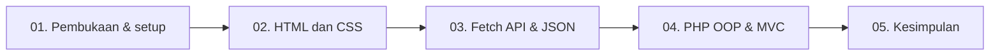

# Panduan & Naskah Video Presentasi Proyek BangunSewa
### Website Promosi dan Katalog Sewa Alat Bangunan

Dokumen ini menjadi panduan perekaman dan naskah presentasi proyek **BangunSewa**. Materi disusun mengikuti perkembangan yang terlihat di repositori: halaman HTML, penyempurnaan CSS, pemuatan data JSON dengan Fetch API, pemodelan data PHP OOP, dan pemisahan aplikasi menggunakan MVC.

> **Catatan sebelum merekam:** Nama anggota, NIM, tautan repositori, dan ketentuan pengumpulan perlu disesuaikan dengan kelompok. Pembagian tiga anggota di bawah adalah usulan agar topik tidak tumpang tindih. Tunjukkan hasil dari kode yang benar-benar tersedia; jangan menyebut formulir sebagai transaksi yang tersimpan.

---

## 1. Tujuan dan Batas Demo

| Topik | Yang ditunjukkan dalam video |
| :--- | :--- |
| **Proyek** | Website informasi dan katalog penyewaan alat bangunan. |
| **Perkembangan antarmuka** | Perbandingan halaman pada folder `Pertama`, `Kedua`, dan `Ketiga`. |
| **Pemuatan data** | `TailWind/Tailwind.html` mengambil enam data alat dari `TailWind/tools.json` melalui Fetch API. |
| **PHP MVC** | `TailWind/index.php` meneruskan permintaan ke Controller, Model menyediakan data, dan View merender katalog. |
| **Batasan fitur** | Data masih berupa contoh di kode/JSON. Formulir demo HTML menampilkan konfirmasi di browser; belum menyimpan permintaan atau mengirimkannya ke backend. |

### Persiapan teknis

- Pastikan PHP tersedia dengan menjalankan `php -v`.
- Untuk demo Fetch dan PHP, jalankan server dari folder proyek:
  ```bash
  php -S localhost:8000
  ```
- Jangan membuka halaman Fetch dengan `file://`; akses melalui server agar `fetch('./tools.json')` dapat membaca JSON.
- Ganti `<URL-REPOSITORI>` dan `<folder-repo>` dengan alamat repositori serta nama folder yang benar jika melakukan demonstrasi clone.

---

## 2. Alur Video dan Pembagian Peran

### 2.1 Alur presentasi



### 2.2 Matriks pembagian yang disarankan

| Anggota | Peran | Cakupan | Berkas utama | Demo |
| :--- | :--- | :--- | :--- | :--- |
| **Anggota 1** | Struktur Halaman & UI | HTML semantik dan evolusi tampilan awal | `Pertama/Index.html`, `Kedua/Index.html`, `Kedua/style.css` | Navigasi bagian Beranda, Daftar Alat, Tentang, dan Kontak; bandingkan tampilan sebelum/sesudah CSS. |
| **Anggota 2** | Responsive UI & Fetch API | CSS responsif serta katalog dinamis berbasis JSON | `Ketiga/Index.html`, `Ketiga/Style.css`, `TailWind/Tailwind.html`, `TailWind/tools.json` | Tampilan mobile, status pemuatan katalog, kartu alat, pilihan alat, dan estimasi harga. |
| **Anggota 3 (Lead)** | PHP OOP & MVC | Objek alat dan alur Model-View-Controller | `TailWind/index.php`, `TailWind/Controller/PeralatanController.php`, `TailWind/Model/PeralatanModel.php`, `TailWind/View/katalog_view.php` | Jalankan server, buka katalog MVC, tunjukkan harga dan data yang dirender dari Model. |

Sesuaikan matriks ini dengan kontribusi yang benar-benar dikerjakan setiap anggota. Jika proyek dikerjakan sendiri atau jumlah anggota berbeda, ubah jumlah pembicara dan pembagian materinya.

---

## 3. Naskah Siap Rekam

### SEGMENT 1 — Pembukaan dan Menjalankan Proyek
**Pembicara:** Anggota 3 / Lead · **Durasi saran:** 1–2 menit

#### Aksi layar

1. Tampilkan terminal.
2. Jika repositori tersedia untuk clone, jalankan:
   ```bash
   git clone <URL-REPOSITORI>
   cd <folder-repo>
   git log --oneline -n 10
   ```
3. Dari root proyek, jalankan `php -S localhost:8000`.
4. Buka proyek di VS Code dan browser.

#### Naskah bicara

> “Assalamu’alaikum warahmatullahi wabarakatuh. Perkenalkan, kami dari kelompok [nama kelompok], yaitu [nama dan NIM anggota]. Pada video ini kami akan mempresentasikan proyek **BangunSewa**, sebuah website informasi dan katalog penyewaan alat bangunan.”
>
> “Kami akan menunjukkan perkembangan halaman dari HTML dan CSS, pemuatan katalog dari file JSON menggunakan Fetch API, serta versi PHP yang memisahkan Model, Controller, dan View. Untuk menjalankan demo PHP, kami menggunakan server lokal PHP pada port 8000.”

Jika repositori belum tersedia secara publik, lewati demonstrasi `git clone` dan jelaskan langkah menjalankan proyek dari folder yang ada. Jangan menampilkan URL clone contoh seolah-olah merupakan repositori asli.

---

### SEGMENT 2 — HTML Semantik dan Perkembangan Tampilan
**Pembicara:** Anggota 1 · **Durasi saran:** 2–3 menit

#### Langkah 2.1 — Struktur halaman

**Aksi layar (VS Code):**

1. Buka `Pertama/Index.html`.
2. Tunjukkan struktur utama: `<header>`, `<nav>`, `<main>`, beberapa `<section>`, dan `<footer>`.
3. Sorot bagian katalog yang memuat kartu Bor Tangan, Gerinda, dan Tangga.
4. Tunjukkan tautan navigasi menuju `#beranda`, `#alat`, `#tentang`, dan `#kontak`.

**Naskah bicara:**

> “Pada versi awal, halaman BangunSewa disusun menggunakan elemen HTML semantik. Bagian header berisi identitas dan navigasi, main menjadi konten utama, lalu section memisahkan beranda, katalog alat, informasi tentang, dan kontak.”
>
> “Katalog awal berisi tiga contoh alat dengan deskripsi dan harga sewa per hari. Tombol pada kartu mengarahkan pengunjung ke bagian kontak untuk menanyakan informasi.”

**Aksi layar (browser):**

1. Buka `http://localhost:8000/Pertama/Index.html`.
2. Klik navigasi **Daftar Alat**, **Tentang**, dan **Kontak**.
3. Tunjukkan bahwa tombol **Lihat Alat** berpindah ke bagian katalog.

#### Langkah 2.2 — CSS eksternal dan layout responsif

**Aksi layar (VS Code):**

1. Buka `Kedua/Index.html` dan tunjukkan stylesheet `style.css` yang dihubungkan melalui `<link>`.
2. Buka `Kedua/style.css`; tunjukkan aturan layout `.hero-content`, `.tool-grid`, dan media query `max-width: 800px`.
3. Bandingkan dengan `Ketiga/Index.html` dan `Ketiga/Style.css`, terutama warna, kartu, navigasi, dan penyesuaian layar kecil.

**Naskah bicara:**

> “Pada tahap berikutnya, styling dipisahkan ke berkas CSS eksternal. CSS mengatur tata letak menggunakan Grid dan Flexbox, jarak, warna, serta tampilan kartu.”
>
> “Media query pada lebar layar maksimal 800 piksel mengubah layout agar lebih sesuai untuk perangkat kecil. Versi Ketiga menyempurnakan hierarki visual, warna, dan gaya komponen dibandingkan versi sebelumnya.”

**Aksi layar (browser):**

1. Buka `http://localhost:8000/Kedua/Index.html`, kemudian `http://localhost:8000/Ketiga/Index.html`.
2. Gunakan DevTools dengan `F12` untuk beralih antara ukuran desktop dan mobile.
3. Perlihatkan perubahan susunan hero, navigasi, dan grid kartu. Jangan mengklaim jumlah kolom mobile yang tidak sesuai dengan hasil yang tampil.

---

### SEGMENT 3 — Tailwind CSS, Fetch API, dan Data JSON
**Pembicara:** Anggota 2 · **Durasi saran:** 3–4 menit

#### Langkah 3.1 — Halaman Tailwind

**Aksi layar (VS Code):**

1. Buka `TailWind/Tailwind.html`.
2. Tunjukkan struktur navigasi, hero, katalog, bagian cara sewa, dan formulir permintaan.
3. Tunjukkan penggunaan utility class Tailwind dan aturan breakpoint untuk layar kecil.

**Naskah bicara:**

> “Versi Tailwind menyusun halaman promosi yang sama dengan utility class untuk warna, spacing, grid, tipografi, dan breakpoint responsif. Halaman ini menyediakan bagian beranda, katalog, langkah penyewaan, dan formulir permintaan.”

#### Langkah 3.2 — Fetch data JSON dan rendering katalog

**Aksi layar (VS Code):**

1. Buka `TailWind/tools.json`; tunjukkan bentuk data seperti `id`, `name`, `category`, `description`, dan `pricePerDay`.
2. Pada `TailWind/Tailwind.html`, cari `const apiUrl = './tools.json'`, fungsi `showApiTools()`, dan fungsi `fetchTools()`.
3. Tunjukkan pembentukan kartu alat dan opsi pilihan alat dari hasil JSON.
4. Tunjukkan status loading, penanganan respons/error, tombol coba lagi, dan pembaruan estimasi harga berdasarkan alat serta jumlah hari.

**Naskah bicara:**

> “Katalog pada halaman ini dimuat dari `tools.json`, yang berisi enam data contoh. Fungsi `fetchTools()` mengambil file tersebut secara asinkron, memeriksa respons dan struktur datanya, lalu meneruskan daftar alat untuk ditampilkan.”
>
> “Fungsi `showApiTools()` membuat kartu dan pilihan alat pada formulir. Saat alat atau durasi berubah, estimasi biaya diperbarui berdasarkan harga harian. Jika pemuatan data gagal, halaman menampilkan informasi status dan menyediakan tombol untuk mencoba kembali.”

**Aksi layar (browser):**

1. Buka `http://localhost:8000/TailWind/Tailwind.html`.
2. Tunjukkan katalog setelah data selesai dimuat.
3. Klik tombol sewa pada salah satu kartu, lalu perlihatkan pilihan alat pada formulir.
4. Ubah lama sewa dan tunjukkan estimasi yang diperbarui.
5. Jika ingin menunjukkan error state, lakukan hanya bila aman untuk demo dan kembalikan file JSON setelahnya.

> **Catatan akurasi:** `tools.json` adalah file JSON statis yang dibaca melalui Fetch API, bukan endpoint REST API. Formulir pada halaman HTML adalah simulasi di browser dan tidak menyimpan permintaan ke server.

---

### SEGMENT 4 — PHP OOP dan Arsitektur MVC
**Pembicara:** Anggota 3 / Lead · **Durasi saran:** 3–4 menit

#### Langkah 4.1 — Model OOP

**Aksi layar (VS Code):**

1. Buka `TailWind/Model/PeralatanModel.php`.
2. Tunjukkan properti bertipe seperti `id`, `name`, `category`, `description`, dan `pricePerDay`.
3. Tunjukkan constructor, getter, `getHargaFormatted()`, dan `getAllData()`.

**Naskah bicara:**

> “Pada versi PHP, `PeralatanModel` merepresentasikan data alat sebagai objek. Constructor mengisi properti, getter menyediakan akses ke data, dan `getHargaFormatted()` memformat harga harian dalam format Rupiah.”
>
> “Method `getAllData()` saat ini mengembalikan enam data contoh langsung dari Model. Jadi data demo ini belum dibaca dari database.”

#### Langkah 4.2 — Controller, View, dan entry point

**Aksi layar (VS Code):**

1. Buka `TailWind/index.php`; tunjukkan pemanggilan berkas Controller dan pembuatan objek Controller.
2. Buka `TailWind/Controller/PeralatanController.php`; jelaskan pemanggilan `PeralatanModel::getAllData()`, pembentukan objek `PeralatanModel`, dan pemuatan View.
3. Buka `TailWind/View/katalog_view.php`; tunjukkan loop `foreach` yang merender kartu dan penggunaan getter untuk nama, kategori, deskripsi, serta harga.

**Naskah bicara:**

> “Alur MVC dimulai dari `index.php` sebagai entry point. Controller meminta data mentah dari Model, mengubah setiap item menjadi objek `PeralatanModel`, lalu meneruskan daftar alat ke View.”
>
> “View bertanggung jawab menampilkan katalog. Data kartu dan opsi alat pada formulir dibaca melalui getter dari objek, sehingga tanggung jawab pengambilan data dan penyajian tampilan berada pada bagian yang berbeda.”

#### Langkah 4.3 — Demo langsung

**Aksi layar (browser):**

1. Pastikan server lokal berjalan dari root proyek.
2. Buka `http://localhost:8000/TailWind/index.php`.
3. Tunjukkan katalog enam alat, nama kategori, sumber gambar, dan harga per hari.
4. Scroll ke bagian cara sewa dan formulir. Jelaskan bahwa formulir PHP pada versi ini belum memiliki handler penyimpanan atau pemrosesan permintaan.

**Naskah bicara:**

> “Berikut hasil render versi MVC di browser. Data katalog berasal dari Model, diproses Controller, lalu ditampilkan oleh View. Fitur yang ditampilkan masih berupa katalog dan formulir antarmuka; belum ada transaksi atau penyimpanan ke database.”

---

### SEGMENT 5 — Kesimpulan dan Kontribusi
**Pembicara:** Anggota 3 / Lead · **Durasi saran:** 1–2 menit

**Aksi layar:** Tampilkan tabel pembagian peran dan halaman katalog terakhir.

**Naskah bicara:**

> “Sebagai kesimpulan, proyek BangunSewa memperlihatkan tahapan pembuatan website promosi dan katalog alat bangunan: dimulai dari HTML semantik, dilanjutkan dengan CSS responsif, pemuatan katalog JSON menggunakan Fetch API, lalu pemisahan data dan tampilan dengan PHP OOP dan MVC.”
>
> “Kontribusi kelompok dibagi sebagai berikut: [nama dan NIM anggota 1] mengerjakan [kontribusi aktual]; [nama dan NIM anggota 2] mengerjakan [kontribusi aktual]; dan [nama dan NIM anggota 3] mengerjakan [kontribusi aktual].”
>
> “Data pada demo masih berupa data contoh dan formulir belum terhubung ke penyimpanan backend. Terima kasih atas perhatian Bapak/Ibu. Wassalamu’alaikum warahmatullahi wabarakatuh.”

---

## 4. Checklist Rekaman

- [ ] Isi nama kelompok, nama/NIM, dan kontribusi yang sebenarnya.
- [ ] Pastikan PHP tersedia dan server dijalankan dari root proyek.
- [ ] Pastikan URL halaman menggunakan ejaan folder yang sesuai, termasuk `TailWind`.
- [ ] Buka halaman melalui `localhost`, khususnya untuk demo Fetch API.
- [ ] Pastikan katalog JSON berhasil dimuat sebelum mulai merekam.
- [ ] Siapkan DevTools untuk menunjukkan layout responsif.
- [ ] Tampilkan kode yang relevan bersamaan dengan hasilnya di browser.
- [ ] Jangan tampilkan nomor WhatsApp atau informasi kontak yang belum dikonfirmasi sebagai kontak aktif.
- [ ] Pastikan deskripsi video dan status publik mengikuti instruksi pengumpulan yang berlaku.

---

## 5. Template Deskripsi Video

Salin dan lengkapi bagian dalam tanda kurung siku sebelum mengunggah:

```text
PRESENTASI PROYEK WEBSITE BANGUNSEWA

Proyek: Website promosi dan katalog sewa alat bangunan
Repositori: <URL-REPOSITORI>

ANGGOTA DAN KONTRIBUSI:
1. [NIM] - [Nama]
   Kontribusi: [Kontribusi aktual]
2. [NIM] - [Nama]
   Kontribusi: [Kontribusi aktual]
3. [NIM] - [Nama]
   Kontribusi: [Kontribusi aktual]

TIMESTAMPS / CHAPTERS:
00:00 Pembukaan dan setup proyek
01:30 Struktur HTML dan navigasi
03:30 CSS dan desain responsif
05:30 Tailwind CSS dan Fetch API
08:30 PHP OOP dan Model
10:00 Controller, View, dan demo MVC
12:00 Kesimpulan dan pembagian kontribusi
```
