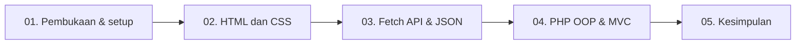

# Panduan & Naskah Video Presentasi Proyek BangunSewa
### Website Promosi dan Katalog Sewa Alat Bangunan

Dokumen ini menjadi panduan perekaman dan naskah presentasi proyek **BangunSewa**. Urutan materi mengikuti kode yang tersedia: **Pekan 2** HTML, **Pekan 3** CSS responsif, **Pekan 4** Fetch API dan JSON, **Pekan 5** PHP OOP, **Pekan 6** View PHP, serta **Pekan 7** alur MVC.

> **Catatan sebelum merekam:** Nama anggota, NIM, tautan repositori, dan ketentuan pengumpulan perlu disesuaikan dengan kelompok. Pembagian tiga anggota di bawah adalah usulan agar topik tidak tumpang tindih. Tunjukkan hasil dari kode yang benar-benar tersedia; jangan menyebut formulir sebagai transaksi yang tersimpan.

---

## 1. Tujuan dan Batas Demo

| Topik | Yang ditunjukkan dalam video |
| :--- | :--- |
| **Proyek** | Website informasi dan katalog penyewaan alat bangunan. |
| **Perkembangan antarmuka** | Perbandingan halaman pada folder `Pertama`, `Kedua`, dan `Ketiga`. |
| **Pemuatan data** | `TailWind/Tailwind.html` mengambil enam data alat dari `TailWind/tools.json` melalui Fetch API. |
| **PHP MVC** | `TailWind/index.php` meneruskan permintaan ke Controller, Model menyediakan data, dan View merender katalog. |
| **Batasan fitur** | Data masih berupa contoh di kode/JSON. Formulir demo HTML menampilkan konfirmasi di browser; belum menyimpan permintaan atau mengirimkannya ke backend. |

### Persiapan teknis

- Pastikan PHP tersedia dengan menjalankan `php -v`.
- Untuk demo Fetch dan PHP, jalankan server dari folder proyek:
  ```bash
  php -S localhost:8000
  ```
- Jangan membuka halaman Fetch dengan `file://`; akses melalui server agar `fetch('./tools.json')` dapat membaca JSON.
- Ganti `<URL-REPOSITORI>` dan `<folder-repo>` dengan alamat repositori serta nama folder yang benar jika melakukan demonstrasi clone.

---

## 2. Alur Video dan Pembagian Peran

### 2.1 Alur presentasi



### 2.2 Matriks pembagian yang disarankan

| Anggota | Peran | Cakupan | Berkas utama | Demo |
| :--- | :--- | :--- | :--- | :--- |
| **Anggota 1** | HTML & CSS Engineer | **Pekan 2–3:** HTML semantik, stylesheet, layout, dan responsive design | `Pertama/Index.html`, `Kedua/Index.html`, `Kedua/style.css`, `Ketiga/Style.css` | Bandingkan halaman awal dengan versi CSS; uji layout desktop dan mobile. |
| **Anggota 2** | Fetch API & PHP OOP Engineer | **Pekan 4–5:** pemuatan JSON dengan Fetch, rendering DOM, status jaringan, dan class Model | `TailWind/Tailwind.html`, `TailWind/tools.json`, `TailWind/Model/PeralatanModel.php` | Tunjukkan katalog JSON, estimasi harga, state fetch, properti/getter PHP, serta format Rupiah. |
| **Anggota 3 (Lead)** | PHP View & MVC Engineer | **Pekan 6–7:** template katalog PHP dan alur Model-Controller-View | `TailWind/View/katalog_view.php`, `TailWind/Controller/PeralatanController.php`, `TailWind/index.php` | Jalankan server, buka katalog MVC, jelaskan data yang diteruskan ke View dan hasil render. |

Sesuaikan matriks ini dengan kontribusi yang benar-benar dikerjakan setiap anggota. Jika proyek dikerjakan sendiri atau jumlah anggota berbeda, ubah jumlah pembicara dan pembagian materinya.

**Panduan membaca naskah:** Label **Dibacakan Anggota 1/2/3** menunjukkan siapa yang berbicara. Aksi layar dilakukan oleh pembicara yang sedang mendapat giliran, kecuali kelompok memilih operator layar tersendiri.

### 2.3 Peta kode yang harus dibuka saat presentasi

Nomor berikut adalah nomor baris pada berkas proyek saat panduan ini disusun. Jika kode berubah, cari nama fungsi/elemen yang disebutkan karena nomor baris bisa bergeser.

#### Anggota 1 — Pekan 2 dan 3: HTML & CSS

- **Pekan 2 — `Pertama/Index.html`:**
  - Baris **10–21**: header dan navigasi.
  - Baris **23–147**: konten utama dan katalog tiga alat.
  - Baris **149–211**: bagian Tentang, Kontak, dan footer.
- **Pekan 3 — `Kedua/Index.html` dan `Kedua/style.css`:**
  - `Kedua/Index.html`, baris **7**: menghubungkan stylesheet eksternal.
  - `Kedua/style.css`, baris **51–60**: layout hero dengan CSS Grid.
  - `Kedua/style.css`, baris **123–172**: grid, kartu alat, dan tombol kartu.
  - `Kedua/style.css`, baris **205–235**: media query untuk layar maksimal 800px; hero dan katalog menjadi satu kolom.
- **Perbandingan desain — `Ketiga/Style.css`:**
  - Baris **24–62**: navbar dan gaya tautan.
  - Baris **64–148**: hero, tombol, dan kartu hero.
  - Baris **170–227**: kartu katalog.
  - Baris **275–309**: penyempurnaan layout responsif.

#### Anggota 2 — Pekan 4 dan 5: Fetch API, JSON, dan PHP OOP

- **Pekan 4 — `TailWind/tools.json`:**
  - Baris **1–54**: struktur JSON dan enam data alat.
- **Pekan 4 — JavaScript di `TailWind/Tailwind.html`:**
  - Baris **389–416**: URL JSON, elemen status, dan pencatatan log.
  - Baris **417–435**: menghitung estimasi harga sewa.
  - Baris **436–525**: membuat kartu katalog dan opsi alat dari JSON.
  - Baris **526–582**: fetch, loading/success/error, validasi data, serta tombol muat ulang.
  - Baris **583–607**: event pilihan alat, durasi, submit formulir demo, dan pemanggilan awal Fetch.
- **Pekan 5 — `TailWind/Model/PeralatanModel.php`:**
  - Baris **4–21**: class, properti private bertipe, dan constructor.
  - Baris **23–34**: getter dan `getHargaFormatted()`.
  - Baris **36–94**: `getAllData()` dan enam data contoh.

#### Anggota 3 — Pekan 6 dan 7: View dan MVC

- **Pekan 6 — `TailWind/View/katalog_view.php`:**
  - Baris **1–12**: awal template HTML dan setup tampilan.
  - Baris **87–122**: loop katalog, kartu, dan getter objek.
  - Baris **127–154**: bagian cara sewa.
  - Baris **156–193**: formulir permintaan dan pilihan alat dari `$daftarAlat`.
- **Pekan 7 — `TailWind/Controller/PeralatanController.php`:**
  - Baris **6–24**: `index()`, mengambil data Model, membuat objek, dan memuat View.
- **Pekan 7 — `TailWind/index.php`:**
  - Baris **1–8**: memuat Controller dan memanggil `index()`.
- **Penghubung Model — `TailWind/Model/PeralatanModel.php`:**
  - Baris **36–94**: sumber enam data contoh yang dipakai dalam alur MVC.

---

## 3. Naskah Siap Rekam

### SEGMENT 1 — Pembukaan dan Menjalankan Proyek
**Pembicara:** Anggota 3 / Lead · **Durasi saran:** 1–2 menit

#### Aksi layar

1. Tampilkan terminal.
2. Jika repositori tersedia untuk clone, jalankan:
   ```bash
   git clone <URL-REPOSITORI>
   cd <folder-repo>
   git log --oneline -n 10
   ```
3. Dari root proyek, jalankan `php -S localhost:8000`.
4. Buka proyek di VS Code dan browser.

#### Naskah bicara — **Dibacakan Anggota 3 (Lead)**

> “Assalamu’alaikum warahmatullahi wabarakatuh. Perkenalkan, kami dari kelompok [nama kelompok], yaitu [nama dan NIM anggota]. Pada video ini kami akan mempresentasikan proyek **BangunSewa**, sebuah website informasi dan katalog penyewaan alat bangunan.”
>
> “Kami akan menunjukkan perkembangan halaman dari HTML dan CSS, pemuatan katalog dari file JSON menggunakan Fetch API, serta versi PHP yang memisahkan Model, Controller, dan View. Untuk menjalankan demo PHP, kami menggunakan server lokal PHP pada port 8000.”

Jika repositori belum tersedia secara publik, lewati demonstrasi `git clone` dan jelaskan langkah menjalankan proyek dari folder yang ada. Jangan menampilkan URL clone contoh seolah-olah merupakan repositori asli.

---

### SEGMENT 2 — HTML Semantik dan Perkembangan Tampilan
**Pekan 2–3 · Pembicara:** Anggota 1 · **Durasi saran:** 2–3 menit

#### Langkah 2.1 — Struktur halaman

**Aksi layar (VS Code):**

1. Buka `Pertama/Index.html`, baris **10–21**, untuk header dan navigasi.
2. Tunjukkan baris **23–147** untuk `<main>`, section, serta kartu katalog Bor Tangan, Gerinda, dan Tangga.
3. Tunjukkan baris **149–211** untuk Tentang, Kontak, dan footer.

**Naskah bicara — Dibacakan Anggota 1:**

> “Terima kasih kepada [Nama Anggota 3]. Saya [Nama Anggota 1, NIM], membawakan Pekan 2 dan Pekan 3. Pada versi awal, halaman BangunSewa disusun menggunakan elemen HTML semantik. Bagian header berisi identitas dan navigasi, main menjadi konten utama, lalu section memisahkan beranda, katalog alat, informasi tentang, dan kontak.”
>
> “Katalog awal berisi tiga contoh alat dengan deskripsi dan harga sewa per hari. Tombol pada kartu mengarahkan pengunjung ke bagian kontak untuk menanyakan informasi.”

**Aksi layar (browser):**

1. Buka `http://localhost:8000/Pertama/Index.html`.
2. Klik navigasi **Daftar Alat**, **Tentang**, dan **Kontak**.
3. Tunjukkan bahwa tombol **Lihat Alat** berpindah ke bagian katalog.

#### Langkah 2.2 — CSS eksternal dan layout responsif

**Aksi layar (VS Code):**

1. Buka `Kedua/Index.html` baris **7** untuk melihat stylesheet `style.css` yang dihubungkan melalui `<link>`.
2. Buka `Kedua/style.css` baris **51–60**, **123–172**, dan **205–235** untuk hero, grid kartu, dan media query.
3. Bandingkan dengan `Ketiga/Style.css` baris **24–62**, **170–227**, dan **275–309** untuk melihat penyempurnaan warna, kartu, dan responsivitas.

**Naskah bicara — Dibacakan Anggota 1:**

> “Pada Pekan 3, styling dipisahkan ke berkas CSS eksternal. Di `Kedua/style.css` baris 51 sampai 60, layout hero menggunakan Grid. Baris 123 sampai 172 mengatur katalog dan kartu alat.”
>
> “Pada baris 205 sampai 235 terdapat media query untuk layar maksimal 800 piksel yang menyusun hero dan katalog menjadi satu kolom. `Ketiga/Style.css` menyempurnakan warna, kartu, dan gaya komponen.”

**Aksi layar (browser):**

1. Buka `http://localhost:8000/Kedua/Index.html`, kemudian `http://localhost:8000/Ketiga/Index.html`.
2. Gunakan DevTools dengan `F12` untuk beralih antara ukuran desktop dan mobile.
3. Perlihatkan perubahan susunan hero, navigasi, dan grid kartu. Jangan mengklaim jumlah kolom mobile yang tidak sesuai dengan hasil yang tampil.

**Naskah bicara — Dibacakan Anggota 1:**

> “Demikian bagian HTML dan CSS dari saya. Selanjutnya, [Nama Anggota 2] akan menjelaskan pemuatan data katalog menggunakan Fetch API dan pemodelan data PHP.”

---

### SEGMENT 3 — Tailwind CSS, Fetch API, dan Data JSON
**Pekan 4–5 · Pembicara:** Anggota 2 · **Durasi saran:** 3–4 menit

#### Langkah 3.1 — Halaman Tailwind

**Aksi layar (VS Code):**

1. Buka `TailWind/Tailwind.html`, baris **27–46** untuk navigasi dan awal konten utama.
2. Tunjukkan utility class Tailwind pada hero di baris **48–80** dan breakpoint `max-[800px]`.
3. Tunjukkan bahwa katalog dan formulir berada di halaman yang sama.

**Naskah bicara — Dibacakan Anggota 2:**

> “Terima kasih, [Nama Anggota 1]. Saya [Nama Anggota 2, NIM], membawakan Pekan 4 dan Pekan 5. Versi Tailwind menyusun halaman promosi dengan utility class untuk warna, spacing, grid, tipografi, dan breakpoint responsif. Halaman ini menyediakan bagian beranda, katalog, langkah penyewaan, dan formulir permintaan.”

#### Langkah 3.2 — Fetch data JSON dan rendering katalog

**Aksi layar (VS Code):**

1. Buka `TailWind/tools.json`, baris **1–54**, untuk melihat enam data alat.
2. Di `TailWind/Tailwind.html`, buka baris **389–416** untuk URL JSON dan status/log Fetch.
3. Tunjukkan baris **417–525** untuk estimasi harga, pembuatan kartu, dan opsi alat.
4. Tunjukkan baris **526–582** untuk proses Fetch, validasi, serta state loading dan error.
5. Tunjukkan baris **583–607** untuk event pilihan, durasi, dan pemanggilan Fetch awal.

**Naskah bicara — Dibacakan Anggota 2:**

> “Memasuki Pekan 4, `TailWind/tools.json` menyediakan enam data contoh. Di `TailWind.html` baris 389 sampai 416 alamat file dan elemen status disiapkan. Fungsi `fetchTools()` pada baris 526 sampai 582 mengambil data secara asinkron, memeriksa respons dan bentuk datanya, lalu menampilkan status pemuatan atau kesalahan.”
>
> “Fungsi `showApiTools()` pada baris 436 sampai 525 membuat kartu dan pilihan alat dari JSON. Di baris 417 sampai 435, estimasi dihitung dari harga harian dan lama sewa. Jika pemuatan data gagal, tombol muat ulang tersedia untuk mencoba kembali.”

**Aksi layar (browser):**

1. Buka `http://localhost:8000/TailWind/Tailwind.html`.
2. Tunjukkan katalog setelah data selesai dimuat.
3. Klik tombol sewa pada salah satu kartu, lalu perlihatkan pilihan alat pada formulir.
4. Ubah lama sewa dan tunjukkan estimasi yang diperbarui.
5. Jika ingin menunjukkan error state, lakukan hanya bila aman untuk demo dan kembalikan file JSON setelahnya.

> **Catatan akurasi:** `tools.json` adalah file JSON statis yang dibaca melalui Fetch API, bukan endpoint REST API. Formulir pada halaman HTML adalah simulasi di browser dan tidak menyimpan permintaan ke server.

#### Langkah 3.3 — Pekan 5: Model PHP dan OOP

**Aksi layar (VS Code):**

1. Buka `TailWind/Model/PeralatanModel.php`.
2. Sorot baris **4–21** untuk class, properti private, dan constructor.
3. Sorot baris **23–34** untuk getter dan method `getHargaFormatted()`.
4. Sorot baris **36–94** untuk `getAllData()` serta enam data alat.

**Naskah bicara — Dibacakan Anggota 2:**

> “Pada Pekan 5, data alat juga dimodelkan menggunakan class `PeralatanModel`. Di baris 4 sampai 21 terdapat properti private bertipe dan constructor yang mengisi nilai setiap properti.”
>
> “Baris 23 sampai 34 berisi getter dan `getHargaFormatted()` untuk menampilkan harga dalam format Rupiah. Kemudian baris 36 sampai 94 menyediakan enam data contoh. Pada versi ini data PHP masih ditulis langsung di Model, belum diambil dari database atau file JSON.”

**Aksi layar (browser):** Anggota 2 kembali ke `http://localhost:8000/TailWind/Tailwind.html`, pilih alat, lalu ubah lama sewa untuk menunjukkan estimasi.

**Naskah bicara — Dibacakan Anggota 2:**

> “Itulah bagian Fetch API dan pemodelan data PHP yang saya presentasikan. Berikutnya, [Nama Anggota 3] akan menjelaskan bagaimana data objek tersebut disiapkan Controller dan dirender oleh View.”

---

### SEGMENT 4 — PHP View dan Arsitektur MVC
**Pekan 6–7 · Pembicara:** Anggota 3 / Lead · **Durasi saran:** 3–4 menit

#### Langkah 4.1 — Pekan 6: View katalog PHP

**Aksi layar (VS Code):**

1. Buka `TailWind/View/katalog_view.php`.
2. Sorot baris **87–122**, terutama loop `foreach` baris 98 dan getter yang mengisi kartu.
3. Sorot baris **127–154** untuk bagian Cara Sewa.
4. Sorot baris **156–193** untuk formulir dan dropdown alat yang dibentuk dari `$daftarAlat`.

**Naskah bicara — Dibacakan Anggota 3 (Lead):**

> “Terima kasih, [Nama Anggota 2]. Saya [Nama Anggota 3, NIM], membawakan Pekan 6 dan Pekan 7. Pada Pekan 6, kita menyiapkan View katalog PHP di `katalog_view.php`. Baris 87 sampai 122 melakukan loop atas `$daftarAlat` dan menggunakan getter objek untuk menampilkan foto, kategori, nama, deskripsi, serta harga.”
>
> “Baris 156 sampai 193 menampilkan formulir permintaan dan pilihan alat yang juga dibangun dari daftar objek. Formulir ini masih sebatas antarmuka; belum mengirim atau menyimpan permintaan.”

#### Langkah 4.2 — Pekan 7: Controller, View, dan entry point

**Aksi layar (VS Code):**

1. Buka `TailWind/index.php`, baris **1–8**, sebagai entry point yang memuat Controller dan memanggil `index()`.
2. Buka `TailWind/Controller/PeralatanController.php`, baris **6–24**, untuk alur mengambil data, membentuk objek, dan memuat View.
3. Sebutkan bahwa sumber data Model ada di `TailWind/Model/PeralatanModel.php`, baris **36–94**; Model dan class sudah diperkenalkan Anggota 2.

**Naskah bicara — Dibacakan Anggota 3 (Lead):**

> “Pada Pekan 7, alur MVC dimulai dari `index.php` baris 1 sampai 8. Berkas ini memuat Controller dan menjalankan method `index()`.”
>
> “Di `PeralatanController.php` baris 6 sampai 24, Controller meminta data dari Model, membungkus tiap data menjadi objek, lalu memuat View. Data contoh Model berada di `PeralatanModel.php` baris 36 sampai 94, sedangkan tampilan katalog berada di `View/katalog_view.php` baris 87 sampai 122. Inilah alur Model, Controller, dan View pada kode proyek.”

#### Langkah 4.3 — Demo langsung

**Aksi layar (browser):**

1. Pastikan server lokal berjalan dari root proyek.
2. Buka `http://localhost:8000/TailWind/index.php`.
3. Tunjukkan katalog enam alat, nama kategori, sumber gambar, dan harga per hari.
4. Scroll ke bagian cara sewa dan formulir. Jelaskan bahwa formulir PHP pada versi ini belum memiliki handler penyimpanan atau pemrosesan permintaan.

**Naskah bicara — Dibacakan Anggota 3 (Lead):**

> “Berikut hasil render versi MVC di browser. Enam alat yang berasal dari Model telah diproses Controller dan ditampilkan oleh View. Fitur yang ditampilkan masih berupa katalog dan formulir antarmuka; belum ada transaksi atau penyimpanan ke database.”

---

### SEGMENT 5 — Kesimpulan dan Kontribusi
**Pembicara:** Anggota 1 membuka kesimpulan, lalu Anggota 1, 2, dan 3 menyebutkan bagian masing-masing · **Durasi saran:** 1–2 menit

**Aksi layar:** Tampilkan tabel pembagian peran dan halaman katalog terakhir.

**Naskah bicara — Dibacakan Anggota 1:**

> “Sebagai kesimpulan, proyek BangunSewa memperlihatkan tahapan pembuatan website promosi dan katalog alat bangunan: mulai dari HTML dan CSS, dilanjutkan Fetch API serta pemodelan PHP OOP, lalu dihubungkan melalui View dan alur MVC.”

**Naskah bicara — Dibacakan Anggota 1:**

> “Saya, [nama dan NIM Anggota 1], membawakan bagian struktur halaman HTML dan perkembangan tampilan antarmuka pada folder `Pertama`, `Kedua`, dan `Ketiga`.”

**Naskah bicara — Dibacakan Anggota 2:**

> “Saya, [nama dan NIM Anggota 2], membawakan bagian katalog dinamis yang mengambil data dari file JSON menggunakan Fetch API, status pemuatan, serta class Model PHP dan format harga Rupiah.”

**Naskah bicara — Dibacakan Anggota 3 (Lead):**

> “Saya, [nama dan NIM Anggota 3], membawakan bagian View PHP dan alur Model-Controller-View. Data pada demo masih berupa data contoh dan formulir belum terhubung ke penyimpanan backend. Terima kasih atas perhatian Bapak/Ibu. Wassalamu’alaikum warahmatullahi wabarakatuh.”

---

## 4. Checklist Rekaman

- [ ] Isi nama kelompok, nama/NIM, dan kontribusi yang sebenarnya.
- [ ] Pastikan PHP tersedia dan server dijalankan dari root proyek.
- [ ] Pastikan URL halaman menggunakan ejaan folder yang sesuai, termasuk `TailWind`.
- [ ] Buka halaman melalui `localhost`, khususnya untuk demo Fetch API.
- [ ] Pastikan katalog JSON berhasil dimuat sebelum mulai merekam.
- [ ] Siapkan DevTools untuk menunjukkan layout responsif.
- [ ] Tampilkan kode yang relevan bersamaan dengan hasilnya di browser.
- [ ] Jangan tampilkan nomor WhatsApp atau informasi kontak yang belum dikonfirmasi sebagai kontak aktif.
- [ ] Pastikan deskripsi video dan status publik mengikuti instruksi pengumpulan yang berlaku.

---

## 5. Template Deskripsi Video

Salin dan lengkapi bagian dalam tanda kurung siku sebelum mengunggah:

```text
PRESENTASI PROYEK WEBSITE BANGUNSEWA

Proyek: Website promosi dan katalog sewa alat bangunan
Repositori: <URL-REPOSITORI>

ANGGOTA DAN KONTRIBUSI:
1. [NIM] - [Nama]
   Peran: HTML & CSS Engineer
   Kontribusi: Pekan 2 (HTML semantik) dan Pekan 3 (stylesheet, layout, responsive design).
   Berkas: Pertama/Index.html, Kedua/Index.html, Kedua/style.css, Ketiga/Style.css
2. [NIM] - [Nama]
   Peran: Fetch API & PHP OOP Engineer
   Kontribusi: Pekan 4 (Fetch API, rendering katalog, dan status jaringan) serta Pekan 5 (Model PHP, getter, dan format Rupiah).
   Berkas: TailWind/Tailwind.html, TailWind/tools.json, TailWind/Model/PeralatanModel.php
3. [NIM] - [Nama]
   Peran: PHP View & MVC Engineer
   Kontribusi: Pekan 6 (View katalog) dan Pekan 7 (Controller, entry point, serta alur MVC).
   Berkas: TailWind/View/katalog_view.php, TailWind/Controller/PeralatanController.php, TailWind/index.php

TIMESTAMPS / CHAPTERS:
00:00 Pembukaan dan setup proyek
01:30 Pekan 2: Struktur HTML semantik dan katalog
03:00 Pekan 3: CSS dan desain responsif
05:00 Pekan 4: Fetch API, data JSON, dan rendering katalog
08:00 Pekan 5: PHP OOP dan PeralatanModel
09:30 Pekan 6: View katalog PHP
11:00 Pekan 7: Controller, entry point, dan demo MVC
13:30 Kesimpulan dan pembagian kontribusi
```
