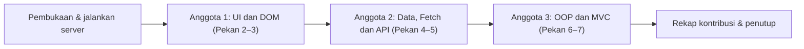

# Panduan & Naskah Video Pengganti UTS (Pekan 2–7)
### BangunSewa — Katalog Sewa Alat Bangunan

Panduan ini membantu kelompok menyiapkan presentasi dan demo langsung website
**BangunSewa**. Materi dibagi untuk tiga anggota berdasarkan bagian kode yang
benar-benar ada: frontend dan DOM, data/API, serta OOP dan MVC.

> **Catatan implementasi:** Katalog berisi enam alat bangunan. Frontend membaca
> `backend/menu.json` secara langsung, sedangkan endpoint PHP
> `backend/api.php` dapat diuji terpisah. Formulir sewa hanya simulasi dan
> belum mengirim atau menyimpan permintaan.

---

## 1. Persiapan & Strategi Presentasi

| Ketentuan / kebutuhan | Eksekusi video |
| --- | --- |
| Pembukaan proyek | Jika repository tersedia, mulai dengan `git clone <URL-repository-kelompok>`, masuk ke folder hasil clone, lalu tampilkan `git log --oneline -n 10`. Ganti placeholder dengan URL asli. |
| Menjalankan aplikasi | Buka terminal di root proyek yang berisi `index.php`, kemudian jalankan `php -S localhost:8000`. |
| Demo yang dapat dibuktikan | Tampilkan frontend interaktif, data JSON/API, dan aplikasi MVC di browser. |
| Pembagian pembahasan | Anggota 1: HTML/UI dan interaksi DOM. Anggota 2: Fetch, data JSON, helper dan API. Anggota 3: class OOP dan MVC. |
| Pengumpulan | Ikuti platform, visibilitas video, dan tenggat yang ditetapkan dosen. Contoh pada naskah acuan: YouTube Public, paling lambat 7 November 2026 pukul 20.00 WIB. |
| Keakuratan presentasi | Jangan menyebut 30 item, kategori makanan/minuman, frontend Fetch ke PHP API, atau transaksi tersimpan. Semua itu tidak sesuai implementasi sekarang. |

### Struktur proyek untuk demo

```text
Promosi/
├── index.php                         # Mengarahkan root ke frontend
├── Pertama/                           # Versi promosi awal
├── Kedua/                             # Versi dengan stylesheet terpisah
├── Ketiga/                            # Versi visual responsif
├── frontend/
│   ├── index.html                     # Halaman BangunSewa
│   └── script.js                      # Fetch JSON, DOM, filter dan form demo
└── backend/
    ├── menu.json                      # Data katalog enam alat
    ├── api.php                        # Endpoint JSON dengan filter
    ├── data/data_menu.php             # Pembaca data JSON untuk PHP
    ├── helpers/functions.php          # Format harga dan filter data
    ├── classes/Peralatan.php          # Class OOP peralatan
    ├── models/PeralatanModel.php
    ├── controllers/PeralatanController.php
    ├── views/katalog_view.php
    ├── views/detail_view.php
    └── index.php                      # Front Controller MVC
```

### 1.1 Alur presentasi



### 1.2 Matriks pembagian tugas

| Anggota | Peran | Pekan | File dan fokus kode | Live demo |
| --- | --- | --- | --- | --- |
| **Anggota 1** | Frontend UI & DOM | **2–3** | `frontend/index.html` baris 11–30 (tema Tailwind), 65+ (struktur semantik), 274–281 (search/filter/grid/paginasi); `frontend/script.js` baris 1–43 (seleksi DOM dan state), 73–208 (filter dan render), 289–299 (event input/paginasi) | Responsif, kategori “Alat listrik”, pencarian “bor”, dan tombol tambah empat kartu |
| **Anggota 2** | Data, Fetch & Core PHP | **4–5** | `frontend/script.js` baris 210–287 (`fetchTools()` dan status); `backend/menu.json`; `backend/data/data_menu.php`; `backend/helpers/functions.php`; `backend/api.php` | Status pemuatan/empty state, respons JSON, filter `?kategori=Alat%20listrik` dan `?q=bor` |
| **Anggota 3 (Lead)** | OOP & MVC | **6–7** | `backend/classes/Peralatan.php`; `backend/models/PeralatanModel.php`; `backend/controllers/PeralatanController.php`; `backend/index.php`; `backend/views/` | Katalog MVC, filter kategori, detail `id=1`, dan halaman 404 `id=999` |

### 1.3 Rincian tugas per anggota

#### 👤 Anggota 1 — Frontend UI & Interaktivitas DOM (Pekan 2–3)

- **Pekan 2 — `frontend/index.html` (bedah kode):**
  - **Baris 3–8:** metadata dokumen, pengaturan viewport agar skala mengikuti
    layar perangkat, deskripsi halaman, dan judul tab browser.
  - **Baris 11–30:** Tailwind dimuat dari CDN. Objek `tailwind.config`
    memperluas warna `earthy` (forest, clay, paper, moss) dan menentukan
    susunan font sans-serif. Ini adalah tema desain yang dipakai oleh class
    utility di seluruh HTML.
  - **Baris 32–42:** CSS kecil untuk scroll halus, jarak saat melompat ke
    anchor, dan warna latar halaman.
  - **Baris 44–63:** `<body>`, header, tombol menu mobile dengan atribut
    aksesibilitas `aria-expanded`/`aria-controls`, serta navigasi ke bagian
    beranda, katalog, cara sewa, dan formulir.
  - **Baris 65–107:** `<main>` dan hero BangunSewa. Sorot tagline layanan,
    ajakan menjelajahi katalog, dan foto Mesin Molen Beton sebagai alat
    unggulan.
  - **Baris 111–258:** bagian katalog dan contoh konten statis tahap awal.
    Jelaskan bahwa contoh ini disembunyikan; kartu aktif diisi secara dinamis
    dari JSON pada kontainer `#api-tools`.
  - **Baris 257–287:** area status Fetch dan katalog aktif: spinner/status
    (`#api-spinner`, `#api-status`), tombol retry (`#retry-api`), input
    pencarian, area tombol filter kategori, grid responsif
    `grid-cols-2 lg:grid-cols-3`, tombol paginasi, dan panel log Fetch.
  - **Baris 297–325:** tiga langkah cara menyewa alat.
  - **Baris 327–389:** formulir simulasi. Field identitas dan jadwal berada
    di sini; `#rental-tool`, `#rental-days`, dan `#rental-estimate` menjadi
    elemen yang dihubungkan dengan JavaScript. Jelaskan bahwa form belum
    mengirim atau menyimpan permintaan.
  - **Baris 391–396:** footer dan pemuatan `script.js` dengan atribut `defer`
    supaya markup selesai dibaca sebelum JavaScript dijalankan.
- **Pekan 3 — `frontend/script.js` (bedah kode):**
  - **Baris 1–18:** memilih tombol/menu navigasi dengan `getElementById()`,
    memasang event klik, memperbarui label aksesibilitas, dan menutup menu
    setelah link dipilih.
  - **Baris 20–43:** URL sumber JSON, referensi DOM katalog/form, dan state
    `availableTools`, `selectedToolId`, `selectedCategory`, serta
    `visibleCount`. State ini mengingat data dan kondisi filter/paginasi
    selama pengguna berinteraksi.
  - **Baris 47–52:** `addApiLog()` membuat item log, menambahkan waktu, dan
    menampilkan pesan diagnostik di Console.
  - **Baris 55–70:** `updateRentalEstimate()` mencari alat yang dipilih,
    memvalidasi lama sewa, lalu mengalikan harga harian dengan jumlah hari
    dan memformat hasil sebagai Rupiah.
  - **Baris 73–97:** `renderCategoryFilters()` membentuk tombol “Semua” dan
    kategori unik dari data. Event klik mengubah kategori, mereset jumlah
    kartu, lalu merender ulang katalog; `aria-pressed` menunjukkan filter
    aktif.
  - **Baris 99–117:** awal `showApiTools()`: membersihkan grid/dropdown dan
    membuat pilihan alat formulir dari data.
  - **Baris 118–130:** pencarian huruf kecil dan filter gabungan kategori
    + teks nama/kategori/deskripsi. Jika hasil kosong, elemen empty state
    dibuat dan dimasukkan ke grid.
  - **Baris 133–199:** membuat setiap kartu dengan `createElement()`.
    Teks pengguna/data dipasang melalui `textContent`; kartu berisi gambar,
    kategori, nama, deskripsi, harga, dan tombol pemilih alat.
  - **Baris 201–207:** menyembunyikan tombol paginasi ketika seluruh hasil
    sudah terlihat, mempertahankan pilihan alat, lalu memperbarui estimasi.
  - **Baris 266–270:** perubahan pilihan alat dan lama sewa memanggil
    `updateRentalEstimate()` sehingga nilai estimasi langsung diperbarui.
  - **Baris 272–287:** submit form dicegah agar tidak reload/mengirim request;
    kode hanya memeriksa pilihan alat, menampilkan konfirmasi simulasi, dan
    menulis log. Gunakan bagian ini untuk menegaskan bahwa belum ada transaksi.
  - **Baris 289–297:** event `input` merender ulang ketika pencarian berubah;
    event klik paginasi menambah `visibleCount` sebanyak empat.
- **Yang disampaikan:** halaman promosi dan susunan section ditulis di HTML,
  sedangkan kartu katalog dibuat oleh JavaScript dari data. Jadi, search dan
  filter tidak mengubah file JSON; keduanya hanya menentukan item yang
  terlihat di browser.
- **Live demo:** Buka `http://localhost:8000/frontend/index.html` → ubah
  ukuran layar lewat DevTools → klik “Alat listrik” → cari “bor” → tekan
  “Lihat Lebih Banyak”.

#### 👤 Anggota 2 — Integrasi Data, Fetch & PHP (Pekan 4–5)

- **Pekan 4 — `frontend/script.js` (bedah kode):**
  - **Baris 22:** `apiUrl` menunjuk ke `../backend/menu.json`. Frontend
    mengambil JSON statis, bukan memanggil `api.php`; pilihan ini membuat
    frontend tetap dapat bekerja pada Live Server yang tidak menjalankan PHP.
  - **Baris 210–223:** `fetchTools()` memulai status loading, mengaktifkan
    spinner, membersihkan kartu lama, menonaktifkan dropdown, dan
    menyembunyikan tombol retry sebelum request.
  - **Baris 225–238:** `fetch()` menunggu response; kode memeriksa `response.ok`,
    membaca JSON, lalu memvalidasi bahwa `data.tools` benar-benar array.
  - **Baris 240–247:** data disimpan di `availableTools`, filter kategori
    dirender, kartu ditampilkan, kontrol form diaktifkan sesuai jumlah data,
    dan status sukses diperbarui.
  - **Baris 249–263:** blok `catch` menampilkan pesan error, menghentikan
    spinner, menonaktifkan pilihan alat, menyediakan tombol retry, mencatat
    log, dan menulis detail error ke Console.
  - **Baris 119–130:** contoh kondisi empty state akibat pencarian atau
    kategori yang tidak menghasilkan kartu. Ini berbeda dari kegagalan
    request: data berhasil dimuat, hanya hasil filter yang kosong.
- **Pekan 5 — data dan helper (bedah kode):**
  - **`backend/menu.json`, baris 1–54:** objek root berisi array `tools`.
    Setiap record memiliki ID, nama, gambar, kategori, deskripsi, dan harga
    harian. Berkas saat ini berisi enam alat, bukan 30 menu.
  - **`backend/data/data_menu.php`, baris 3–19:** `getDataMenu()` menentukan
    path relatif terhadap file (`__DIR__`), membaca JSON, melempar error jika
    file gagal dibaca, mem-parsing JSON dengan `JSON_THROW_ON_ERROR`, lalu
    memeriksa struktur `tools`.
  - **`backend/helpers/functions.php`, baris 3–6:** `formatRupiah()` memakai
    `number_format()` dengan pemisah ribuan titik dan tanpa angka desimal.
  - **Baris 8–24:** `saringMenu()` menormalkan keyword dan teks data menjadi
    huruf kecil, lalu mencocokkan keyword pada nama, kategori, dan deskripsi.
    `array_values()` merapikan kembali indeks hasil filter.
  - **Baris 26–35:** `saringMenuByKategori()` mengembalikan seluruh data bila
    kategori kosong, atau menyaring kategori secara case-insensitive.
  - **`backend/api.php`, baris 3–6:** memuat data/helper dan menetapkan header
    `application/json; charset=utf-8`.
  - **Baris 8–15:** mengambil query `kategori` dan `q`, menerapkan filter
    berurutan, lalu menghasilkan objek JSON dengan properti `tools`.
  - **Baris 16–22:** error data/JSON mengembalikan status HTTP 500 dan body
    JSON error, bukan HTML.
- **Penjelasan tambahan:** Frontend menggunakan file JSON langsung supaya
  tetap kompatibel dengan server statis/Live Server. Endpoint PHP adalah
  jalur demonstrasi tersendiri, bukan URL yang dipakai frontend saat ini.
  API dan MVC membaca data JSON yang sama melalui `data_menu.php`.
- **Live demo:** Tampilkan frontend saat data berhasil dimuat dan empty state
  dengan pencarian acak. Kemudian buka:
  - `http://localhost:8000/backend/api.php`
  - `http://localhost:8000/backend/api.php?kategori=Alat%20listrik`
  - `http://localhost:8000/backend/api.php?q=bor`

#### 👤 Anggota 3 (Lead) — OOP, MVC & Integrasi (Pekan 6–7)

- **Opening:** Tampilkan proses clone repository bila URL sudah tersedia,
  `git log`, root proyek, lalu jalankan `php -S localhost:8000`.
- **Pekan 6 — `backend/classes/Peralatan.php`:**
  - **Baris 3–5:** memuat helper harga dan memulai deklarasi class `Peralatan`.
  - **Baris 7–16:** constructor property promotion mendeklarasikan serta
    menginisialisasi tujuh properti privat bertipe. Jelaskan bahwa private
    mencegah kode lain mengubah properti secara langsung.
  - **Baris 18–25:** getter menyediakan akses terkontrol; `getHargaFormatted()`
    menyerahkan format mata uang ke helper `formatRupiah()`.
  - **Baris 27–30:** `isBestSeller()` memberi contoh method bisnis sederhana
    (saat ini menganggap ID 4 sebagai best seller).
  - **Baris 32–51:** `renderKartu(): string` menyiapkan nilai yang di-escape
    melalui `htmlspecialchars()`, kemudian mengembalikan markup kartu.
    Jelaskan bahwa view katalog saat ini memiliki template rendering sendiri;
    method ini adalah kemampuan class, bukan fungsi yang sedang dipakai oleh
    loop katalog MVC.
- **Pekan 7 — MVC:**
  - **Root `index.php`, baris 1–4:** halaman root mengirim redirect ke
    `/frontend/index.html`. File ini bukan router MVC.
  - **`backend/index.php`, baris 3–6:** memuat Controller, membuat instance,
    dan memakai `index` sebagai action default.
  - **Baris 8–19:** merutekan action `show` ke detail; action tidak dikenal
    memperoleh status 404; selain itu Controller menampilkan katalog.
  - **`backend/controllers/PeralatanController.php`, baris 3–9:** dependency
    Model dimuat dan disediakan pada constructor.
  - **Baris 11–16:** `index()` membaca `kategori` dari query string, meminta
    data terfilter dari Model, lalu memuat view katalog.
  - **Baris 18–28:** `show()` memvalidasi ID sebagai integer, mencari alat,
    menetapkan status 404 jika tidak ditemukan, dan memuat view detail.
  - **`backend/models/PeralatanModel.php`, baris 3–7:** memuat pembaca data,
    class entitas, helper, dan mendeklarasikan Model.
  - **Baris 9–25:** `getAll()` membaca data, menerapkan filter kategori,
    lalu memakai `array_map()` untuk membungkus tiap record menjadi objek
    `Peralatan`.
  - **Baris 27–37:** `findById()` mengembalikan objek yang ID-nya cocok atau
    `null` bila tidak ditemukan.
  - **`backend/views/katalog_view.php`, baris 1–7:** menyiapkan data default,
    kategori aktif/tersedia, alat hero, dan fungsi escape HTML.
  - **Baris 92–109:** bagian katalog, link filter kategori, grid responsif,
    dan awal loop yang menghasilkan kartu dari objek.
  - **Baris 109–139:** markup kartu, getter objek, output ter-escape, link ke
    detail, dan empty state untuk kategori tanpa alat.
  - **Baris 171–204:** formulir demo MVC dan opsi alat yang dibuat dari daftar
    objek.
  - **`backend/views/detail_view.php`, baris 1–3:** fungsi escape untuk
    menjaga output teks/atribut.
  - **Baris 14–25:** kondisi detail ditemukan atau tidak ditemukan. Kondisi
    kosong menampilkan pesan 404, sedangkan kondisi sukses menampilkan foto,
    kategori, nama, deskripsi, dan harga.
- **Alur yang perlu diterangkan:** browser meminta `backend/index.php` →
  Front Controller memilih action → Controller meminta data ke Model → Model
  membaca JSON dan membangun objek `Peralatan` → Controller memuat View →
  View mengirim HTML ke browser.
- **Live demo:**
  `http://localhost:8000/backend/index.php` → filter “Alat listrik” →
  `http://localhost:8000/backend/index.php?action=show&id=1` →
  `http://localhost:8000/backend/index.php?action=show&id=999`.
- **Closing:** rangkum kontribusi semua anggota serta batasan bahwa formulir
  belum menyimpan permintaan.

---

## 2. Naskah Siap Rekam

Ganti placeholder nama, NIM, kelompok, dan repository sebelum merekam.

### Segmen 1 — Pembukaan & Inisialisasi (Anggota 3 / Lead)

**Durasi saran:** sekitar 1,5 menit.

**Aksi layar (terminal):**

1. Tampilkan terminal.
2. Jika repository tersedia, jalankan `git clone <URL-repository-kelompok>`.
3. Masuk ke folder proyek hasil clone, lalu jalankan `git log --oneline -n 10`.
4. Buka root proyek di VS Code. Di terminal root yang berisi `index.php`,
   jalankan `php -S localhost:8000`.

**Naskah bicara:**

> “Assalamu’alaikum warahmatullahi wabarakatuh. Kami dari kelompok
> [nama kelompok], beranggotakan [nama anggota], akan mempresentasikan proyek
> **BangunSewa — Katalog Sewa Alat Bangunan**. Proyek ini menyajikan informasi
> alat bangunan, kategori, foto, dan harga sewa per hari.
>
> Kami memulai dengan menampilkan repository dan riwayat pengerjaan. Server
> PHP dijalankan dari folder utama proyek yang berisi `index.php`, dengan
> perintah `php -S localhost:8000`. Halaman utama dapat dibuka melalui
> `http://localhost:8000/`, sedangkan frontend juga dapat dibuka langsung
> melalui `/frontend/index.html`.
>
> Untuk struktur antarmuka dan interaksi katalog, penjelasan dilanjutkan oleh
> [Nama Anggota 1].”

### Segmen 2 — Pekan 2–3: UI & Interaksi DOM (Anggota 1)

**Durasi saran:** sekitar 3,5 menit.

**Aksi layar (VS Code):**

1. Buka `frontend/index.html`, tunjukkan konfigurasi Tailwind dan elemen
   semantik.
2. Tunjukkan area katalog: search, filter kategori, grid, dan paginasi.
3. Buka `frontend/script.js`, tunjukkan `renderCategoryFilters()`,
   `showApiTools()`, dan event listener pencarian/paginasi.

**Naskah bicara:**

> “Terima kasih [Nama Anggota 3]. Saya [Nama Anggota 1, NIM] membahas
> antarmuka dan interaksi pengguna pada Pekan 2 dan 3.
>
> Pada Pekan 2, `frontend/index.html` menyusun halaman BangunSewa menggunakan
> elemen semantik seperti `header`, `main`, `section`, dan `footer`. Tema
> Tailwind memakai warna hijau, oranye, dan latar terang yang sesuai dengan
> identitas penyewaan alat bangunan. Grid katalog menggunakan dua kolom pada
> layar kecil dan tiga kolom pada breakpoint `lg`.
>
> Pada Pekan 3, `frontend/script.js` memilih elemen halaman melalui DOM API.
> Fungsi `renderCategoryFilters()` membuat tombol kategori, sedangkan
> `showApiTools()` menyaring data dan membuat kartu alat secara dinamis. Kolom
> search memeriksa nama, kategori, dan deskripsi. Tombol ‘Lihat Lebih Banyak’
> menambahkan empat kartu setiap kali ditekan.”

**Aksi layar (browser):** buka frontend, uji mode mobile dan desktop, pilih
“Alat listrik”, cari “bor”, lalu klik “Lihat Lebih Banyak”.

**Naskah bicara:**

> “Di browser, tampilan menyesuaikan lebar layar. Filter ‘Alat listrik’
> memperlihatkan kategori tersebut, pencarian ‘bor’ menemukan Bor Tangan, dan
> tombol paginasi menambah kartu tanpa memuat ulang halaman. Jika tidak ada
> hasil yang cocok, katalog menampilkan pesan empty state.”

> “Selanjutnya [Nama Anggota 2] menjelaskan sumber data, Fetch, dan API.”

### Segmen 3 — Pekan 4–5: JSON, Fetch & API PHP (Anggota 2)

**Durasi saran:** sekitar 3,5 menit.

**Aksi layar (VS Code):** tunjukkan `fetchTools()` dan URL data di
`frontend/script.js`, kemudian `backend/menu.json`,
`backend/data/data_menu.php`, `backend/helpers/functions.php`, dan
`backend/api.php`.

**Naskah bicara:**

> “Terima kasih [Nama Anggota 1]. Saya [Nama Anggota 2, NIM] membahas pemuatan
> data pada Pekan 4 dan pemrosesan PHP pada Pekan 5.
>
> Frontend memakai `async/await` dan Fetch API untuk membaca
> `backend/menu.json`. Data dipisahkan dari markup sehingga kartu katalog
> dibuat berdasarkan isi JSON. Fungsi `fetchTools()` menangani status loading,
> success, dan error. Pengunjung juga dapat mencoba kembali ketika data gagal
> dimuat. Empty state ditampilkan jika pencarian atau filter tidak menemukan
> alat.
>
> Pada sisi PHP, `data_menu.php` membaca dan memvalidasi JSON. Helper
> `formatRupiah()` memformat harga, sedangkan `saringMenu()` dan
> `saringMenuByKategori()` mengolah hasil pencarian dan kategori. Endpoint
> `api.php` menyajikan hasil tersebut sebagai JSON.”

**Aksi layar (browser):** tunjukkan pesan empty state di frontend, lalu buka
endpoint API dan URL filter kategori.

**Naskah bicara:**

> “Penting untuk membedakan alurnya: frontend membaca file JSON langsung agar
> bisa dijalankan di Live Server. Endpoint `backend/api.php` adalah endpoint
> PHP yang dapat diuji terpisah, dan menggunakan sumber data yang sama. Pada
> URL API, parameter `kategori` membatasi kategori alat dan parameter `q`
> mencari kata kunci.”

> “Berikutnya [Nama Anggota 3] menjelaskan OOP dan arsitektur MVC.”

### Segmen 4 — Pekan 6–7: OOP & MVC (Anggota 3 / Lead)

**Durasi saran:** sekitar 4,5 menit.

**Aksi layar (VS Code):** tunjukkan class `Peralatan`, Model, Controller,
Front Controller, serta kedua view.

**Naskah bicara:**

> “Pada Pekan 6, class `Peralatan` menjadi representasi satu alat bangunan.
> Class ini memiliki properti privat bertipe, constructor, getter,
> `getHargaFormatted()`, dan contoh method bisnis `isBestSeller()`.
> Method `renderKartu()` juga menunjukkan bagaimana objek dapat menyediakan
> markup kartu dengan nilai yang di-escape.
>
> Pada Pekan 7, proyek memisahkan alur PHP menjadi Model, View, dan Controller.
> `backend/index.php` membaca action. `PeralatanController` memilih alur
> katalog atau detail. `PeralatanModel` membaca data dan membuat objek
> `Peralatan`. View kemudian menampilkan katalog atau informasi detail.
>
> Jika ID detail tidak ditemukan, Controller menetapkan status HTTP 404 dan
> View menampilkan pesan bahwa alat tidak tersedia.”

**Aksi layar (browser):** buka katalog MVC, gunakan filter kategori, buka
detail ID 1, kemudian ID 999.

**Naskah bicara:**

> “Kita dapat melihat katalog MVC dan filter server-side. Rute detail ID 1
> menampilkan Bor Tangan, sedangkan ID 999 menampilkan halaman tidak
> ditemukan dengan status 404. Dengan demikian, request berjalan melalui
> Front Controller, Controller, Model, dan View.”

### Segmen 5 — Penutup & Rekap Kontribusi

**Durasi saran:** sekitar 2 menit.

**Naskah bicara (Anggota 3):**

> “Sebagai rekap, [Nama Anggota 1] bertanggung jawab atas HTML, tampilan
> responsif, dan interaksi DOM; [Nama Anggota 2] menangani Fetch, data JSON,
> helper PHP, serta endpoint API; dan [Nama Anggota 3] menangani class OOP
> serta arsitektur MVC.
>
> BangunSewa saat ini merupakan katalog dan simulasi permintaan. Data belum
> disimpan ke database dan formulir belum mengirim pesanan. Demikian
> presentasi proyek kami. Terima kasih atas perhatian Bapak/Ibu dosen.
> Wassalamu’alaikum warahmatullahi wabarakatuh.”

### Chapter / timestamp (sesuaikan setelah editing)

```text
00:00 Pembukaan, repository, dan menjalankan server
01:30 Pekan 2: HTML semantik dan sistem desain BangunSewa
03:15 Pekan 3: DOM, filter, pencarian, dan paginasi
05:10 Pekan 4: Fetch JSON dan status frontend
07:05 Pekan 5: Helper PHP dan endpoint API
08:50 Pekan 6: OOP dan class Peralatan
10:45 Pekan 7: Arsitektur MVC dan routing
13:15 Demo katalog frontend, API, dan MVC
14:30 Rekap kontribusi anggota dan penutup
```

---

## 3. Panduan Teknis Rekaman

1. Pastikan PHP tersedia dengan menjalankan `php -v`.
2. Buka terminal pada **root proyek**, yaitu folder yang berisi `index.php`,
   lalu jalankan:
   ```powershell
   php -S localhost:8000
   ```
3. Buka halaman dan rute demo berikut:
   - Root redirect: <http://localhost:8000/>
   - Frontend: <http://localhost:8000/frontend/index.html>
   - JSON sumber: <http://localhost:8000/backend/menu.json>
   - API: <http://localhost:8000/backend/api.php>
   - API filter: <http://localhost:8000/backend/api.php?kategori=Alat%20listrik>
   - Katalog MVC: <http://localhost:8000/backend/index.php>
   - MVC kategori: <http://localhost:8000/backend/index.php?kategori=Alat%20listrik>
   - Detail alat: <http://localhost:8000/backend/index.php?action=show&id=1>
   - Uji 404: <http://localhost:8000/backend/index.php?action=show&id=999>
4. Jangan menutup terminal server saat browser sedang digunakan.
5. Isi placeholder nama, NIM, URL GitHub, kelas, dan informasi pengumpulan
   berdasarkan instruksi dosen sebelum mengirim video.
6. Untuk rekaman bersama, gunakan resolusi layar yang mudah dibaca, tampilkan
   terminal serta browser saat demo, dan pastikan setiap anggota mendapat
   giliran berbicara. Jika ada kesalahan bicara, ulangi kalimat setelah jeda
   singkat agar mudah dipotong saat penyuntingan.

---

## 4. Template Isian & Deskripsi Video

### Isian pengumpulan

- **Tema:** BangunSewa — Katalog Sewa Alat Bangunan
- **NIM dan nama:**
  - [NIM Anggota 1] — [Nama Anggota 1]
  - [NIM Anggota 2] — [Nama Anggota 2]
  - [NIM Anggota 3] — [Nama Anggota 3]
- **Link GitHub:** [URL repository kelompok]
- **Link video:** [URL video YouTube; atur visibilitas sesuai instruksi dosen]

### Deskripsi video (salin dan lengkapi)

```text
TUGAS PENGGANTI UTS PEMROGRAMAN WEB

Nama Proyek: BangunSewa — Katalog Sewa Alat Bangunan
Repositori: [URL repository kelompok]

ANGGOTA DAN PEMBAGIAN KONTRIBUSI:
1. [NIM Anggota 1] - [Nama Anggota 1]
   Peran: Frontend UI & DOM
   Kontribusi: Struktur HTML semantik, tema Tailwind responsif, rendering
   kartu, filter kategori, pencarian, dan paginasi.
   File: frontend/index.html, frontend/script.js

2. [NIM Anggota 2] - [Nama Anggota 2]
   Peran: Integrasi Data & API
   Kontribusi: Fetch JSON, status loading/error/empty, pembaca data PHP,
   helper, serta endpoint JSON dengan filter.
   File: frontend/script.js, backend/menu.json, backend/data/data_menu.php,
   backend/helpers/functions.php, backend/api.php

3. [NIM Anggota 3] - [Nama Anggota 3]
   Peran: Lead, OOP & MVC
   Kontribusi: Class Peralatan, Model, Controller, routing Front Controller,
   katalog MVC, halaman detail, dan penanganan 404.
   File: backend/classes/Peralatan.php, backend/models/PeralatanModel.php,
   backend/controllers/PeralatanController.php, backend/index.php,
   backend/views/

Catatan: Frontend membaca backend/menu.json secara langsung.
Endpoint PHP API didemonstrasikan secara terpisah. Formulir sewa adalah
simulasi dan belum menyimpan atau mengirim transaksi.
```
