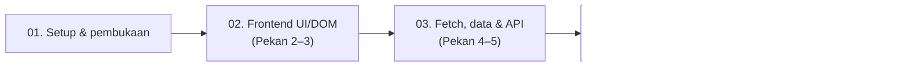

# Panduan & Naskah Siap Rekam Video Pengganti UTS (Pekan 2–7)
### Tim Pengembang Web J — BangunSewa, Katalog Sewa Alat Bangunan

Panduan ini adalah panduan operasional perekaman video **Tugas Pengganti UTS
Pemrograman Web**. Materi disusun untuk tiga orang anggota dengan pembagian
per layer: Frontend UI/DOM (Pekan 2–3), Fetch, data dan PHP API (Pekan 4–5),
serta OOP/MVC (Pekan 6–7). Setiap bagian menghubungkan kode yang benar-benar
ada di proyek dengan hasil yang dapat ditunjukkan secara langsung.

> **Catatan agar demo sesuai implementasi:** BangunSewa adalah katalog sewa
> alat bangunan dengan enam data contoh. Frontend mengambil
> `backend/menu.json` secara langsung; `backend/api.php` merupakan endpoint PHP
> terpisah yang membaca sumber data sama. Formulir sewa hanya simulasi dan
> belum mengirim maupun menyimpan pesanan.

---

## 1. Aturan Mutlak & Strategi Eksekusi

| Ketentuan | Standar eksekusi video kelompok |
| :--- | :--- |
| **Layar awal Git Clone** | Bila repositori kelompok tersedia, mulai dari terminal, jalankan `git clone <url-repo-asli>`, masuk ke folder hasil clone, tampilkan `git log --oneline -n 10`, kemudian jalankan server. Jangan membiarkan placeholder URL pada rekaman. |
| **Kode dan output harus selaras** | Bahas struktur HTML, interaksi DOM, pemuatan data JSON, helper/API PHP, OOP, serta MVC; setelahnya buktikan fitur di browser. |
| **Hasil running terlihat nyata** | Gunakan URL lokal yang dicantumkan di panduan. Tunjukkan hasil dari server yang sedang berjalan. |
| **Pembagian kode tiap anggota berbeda** | Anggota 1: Frontend UI/DOM (W2–3). Anggota 2: Fetch, data, helper dan API (W4–5). Anggota 3: OOP/MVC dan integrasi (W6–7). |
| **Platform pengumpulan** | Ikuti ketentuan dosen. Naskah acuan menyebut YouTube Public dan tenggat 7 November 2026 pukul 20.00 WIB; pastikan kembali sebelum pengumpulan. |
| **Pernyataan fitur harus akurat** | Jangan menyebut menu makanan, 30 data, frontend terhubung ke PHP API, atau pesanan tersimpan. Semua itu tidak sesuai implementasi BangunSewa saat ini. |

### Struktur proyek yang digunakan

```text
Promosi/
├── index.php                           # Redirect root ke frontend
├── Pertama/
│   └── Index.html                      # Versi halaman promosi awal
├── Kedua/
│   ├── Index.html                      # Versi dengan stylesheet terpisah
│   └── style.css
├── Ketiga/
│   ├── Index.html                      # Versi visual yang disempurnakan
│   └── Style.css
├── frontend/
│   ├── index.html                      # Halaman utama BangunSewa
│   ├── script.js                       # DOM, Fetch JSON, filter, form demo
│   ├── main.css                        # Sumber stylesheet Tailwind
│   └── output.css                      # Hasil build Tailwind yang tersedia
└── backend/
    ├── menu.json                       # Sumber data katalog enam alat
    ├── api.php                         # Endpoint data JSON
    ├── data/data_menu.php              # Pembaca JSON untuk PHP
    ├── helpers/functions.php           # Formatter Rupiah dan filter data
    ├── classes/Peralatan.php           # Class entitas alat
    ├── models/PeralatanModel.php       # Model katalog
    ├── controllers/PeralatanController.php
    ├── views/
    │   ├── katalog_view.php
    │   └── detail_view.php
    └── index.php                       # Front Controller MVC
```

### 1.1 Alur presentasi



### 1.2 Tabel pembagian tugas & baris kode kunci

| Anggota | Peran | Pekan | Berkas dan bagian kode | Fokus live demo |
| :--- | :--- | :--- | :--- | :--- |
| **Anggota 1** | Frontend UI & DOM Engineer | **2–3** | `frontend/index.html` baris 11–30 (tema Tailwind), 44–107 (header/hero/struktur semantik), 257–287 (status, search, filter, grid, paginasi); `frontend/script.js` baris 1–43, 73–208, 289–297 | Responsivitas; filter “Alat listrik”; pencarian “bor”; tombol tambah empat kartu |
| **Anggota 2** | Data, Fetch & Core PHP Engineer | **4–5** | `frontend/script.js` baris 210–263 (loading/success/error); `backend/menu.json`; `backend/data/data_menu.php` baris 3–19; `backend/helpers/functions.php` baris 3–35; `backend/api.php` baris 3–22 | Status frontend, empty state, JSON API, filter `?kategori=Alat%20listrik` dan `?q=bor` |
| **Anggota 3 (Lead)** | OOP & MVC Architect | **6–7** | `backend/classes/Peralatan.php`; `backend/index.php`; `backend/controllers/PeralatanController.php`; `backend/models/PeralatanModel.php`; `backend/views/katalog_view.php`; `backend/views/detail_view.php` | Git/server; katalog MVC; kategori server-side; rute detail ID 1 dan 404 ID 999 |

### 1.3 Rincian tugas & penjelasan kode per anggota

#### 👤 Anggota 1 — Frontend UI & Interaktivitas DOM (Pekan 2 & 3)

**Pekan 2 — `frontend/index.html`:**

- **Baris 3–8:** metadata dokumen, pengaturan viewport, deskripsi website,
  dan judul tab “BangunSewa - Sewa Alat Bangunan”.
- **Baris 11–30:** Tailwind CSS dimuat melalui CDN. Konfigurasi
  `tailwind.config` memperluas warna `earthy` (forest, clay, paper, moss) dan
  mengatur font sans-serif. Utility class pada halaman memakai tema ini.
- **Baris 32–42:** pengaturan scroll halus, jarak saat melompat ke bagian
  halaman, dan latar dasar.
- **Baris 44–63:** header dan navigasi. Tombol menu mobile menggunakan
  `aria-expanded` dan `aria-controls`; link mengarah ke beranda, katalog,
  cara sewa, dan formulir.
- **Baris 65–107:** elemen `<main>` dan hero BangunSewa, berisi promosi sewa
  alat, tombol ke katalog/cara sewa, serta gambar Mesin Molen Beton.
- **Baris 111–258:** bagian katalog dan contoh kartu statis tahap awal.
  Konten kartu statis disembunyikan; kartu aktif diisi oleh JavaScript di
  elemen `#api-tools`.
- **Baris 257–287:** area pemuatan katalog: spinner `#api-spinner`, status
  `#api-status`, tombol retry `#retry-api`, input search, kontainer filter,
  grid `grid-cols-2 lg:grid-cols-3`, tombol `#load-more`, dan log Fetch.
- **Baris 297–325:** bagian “Cara menyewa alat” dengan tiga langkah.
- **Baris 327–389:** formulir simulasi, termasuk pilihan alat, tanggal, lama
  sewa, estimasi harga, dan pesan status. Form ini tidak menyimpan pesanan.
- **Baris 391–396:** footer dan pemanggilan `script.js` dengan `defer`, agar
  script dijalankan setelah markup HTML selesai diparsing.

**Pekan 3 — `frontend/script.js`:**

- **Baris 1–18:** memilih tombol dan navigasi dengan `getElementById()`,
  memasang event klik, mengubah status aksesibilitas, dan menutup menu setelah
  link dipilih.
- **Baris 20–43:** menyimpan referensi elemen katalog/form, URL JSON, serta
  state `availableTools`, `selectedToolId`, `selectedCategory`, dan
  `visibleCount`.
- **Baris 55–70:** `updateRentalEstimate()` mencari alat terpilih, memeriksa
  jumlah hari, mengalikan harga per hari, dan menampilkan estimasi berformat
  Rupiah.
- **Baris 73–97:** `renderCategoryFilters()` membuat filter “Semua” dan
  kategori unik. Klik filter memperbarui kategori aktif, mereset paginasi,
  dan merender ulang kartu; `aria-pressed` menyatakan tombol yang aktif.
- **Baris 99–117:** `showApiTools()` mengosongkan kontainer dan menyusun
  pilihan alat pada dropdown formulir berdasarkan data.
- **Baris 118–130:** pencarian huruf kecil menggabungkan kecocokan kategori
  dengan nama/kategori/deskripsi. Jika hasil tidak ada, fungsi menampilkan
  empty state.
- **Baris 133–199:** kartu dibuat dengan `document.createElement()`. Teks
  dipasang melalui `textContent`; kartu memuat gambar, atribusi, kategori,
  nama, deskripsi, harga, dan tombol pemilihan alat.
- **Baris 201–207:** mengatur visibilitas tombol paginasi, mempertahankan
  pilihan alat, dan memperbarui estimasi.
- **Baris 266–270:** perubahan pilihan alat atau lama sewa menghitung ulang
  estimasi secara langsung.
- **Baris 272–287:** submit form dicegah agar tidak mengirim request; halaman
  hanya memvalidasi alat, menampilkan konfirmasi simulasi, dan menulis log.
- **Baris 289–297:** event `input` menjalankan pencarian realtime; klik
  “Lihat Lebih Banyak” menambah batas item yang terlihat sebanyak empat.

**Penjelasan yang disampaikan:** markup HTML membangun bagian promosi dan
kontrol katalog, sedangkan kartu dibuat dinamis dari data. Search dan filter
hanya mengubah daftar yang terlihat di browser, bukan file sumber data.
Grid katalog memakai dua kolom hingga breakpoint `lg`, kemudian tiga kolom.

**Live demo:** buka `http://localhost:8000/frontend/index.html` → ubah ukuran
layar lewat DevTools → klik “Alat listrik” → cari “bor” → pilih “Semua” lalu
klik “Lihat Lebih Banyak”. Karena data berjumlah enam, tampilan bertambah dari
empat kartu menjadi enam.

#### 👤 Anggota 2 — Integrasi Data, Fetch & PHP Prosedural (Pekan 4 & 5)

**Pekan 4 — `frontend/script.js`:**

- **Baris 22:** `apiUrl` menunjuk ke `../backend/menu.json`. Frontend
  mengambil file JSON langsung agar tetap bekerja melalui Live Server.
  Frontend tidak memanggil `backend/api.php`.
- **Baris 210–223:** `fetchTools()` memulai status loading, mengaktifkan
  spinner, membersihkan katalog, menonaktifkan dropdown, dan menyembunyikan
  tombol retry.
- **Baris 225–238:** `fetch()` menunggu respons, mengecek `response.ok`,
  membaca JSON, dan memvalidasi `data.tools` sebagai array.
- **Baris 240–247:** menyimpan data, membuat ulang filter, merender kartu,
  mengaktifkan dropdown sesuai ketersediaan alat, dan menampilkan status
  berhasil.
- **Baris 249–263:** blok `catch` menampilkan error, menghentikan spinner,
  menonaktifkan pilihan, menampilkan tombol retry, serta mencatat detail di
  log dan Console.
- **Baris 118–130:** empty state untuk pencarian/filter tanpa hasil. Ini
  berbeda dari error jaringan: data berhasil dimuat, tetapi tidak ada kartu
  yang cocok.

**Pekan 5 — `backend/data/`, `backend/helpers/`, dan API:**

- **`backend/menu.json`, baris 1–54:** array `tools` berisi enam alat.
  Setiap objek menyimpan `id`, `name`, `imageUrl`, opsional `imageSource`,
  `category`, `description`, dan `pricePerDay`.
- **`backend/data/data_menu.php`, baris 3–19:** `getDataMenu()` membaca file
  relatif terhadap `__DIR__`, melempar error jika file tidak terbaca,
  mem-parsing JSON dengan `JSON_THROW_ON_ERROR`, memvalidasi bentuk `tools`,
  lalu mengembalikan array data.
- **`backend/helpers/functions.php`, baris 3–6:** `formatRupiah()` memakai
  `number_format()` dengan pemisah ribuan titik dan tanpa pecahan desimal.
- **Baris 8–24:** `saringMenu()` menormalkan kata kunci dan teks item ke huruf
  kecil, lalu mencocokkan kata pada nama, kategori, atau deskripsi.
- **Baris 26–35:** `saringMenuByKategori()` mengembalikan semua data bila
  kategori kosong atau memfilter kategori secara case-insensitive.
- **`backend/api.php`, baris 3–6:** memuat pembaca data/helper dan menetapkan
  `Content-Type: application/json; charset=utf-8`.
- **Baris 8–15:** membaca query `kategori` dan `q`, menerapkan kedua filter,
  kemudian membentuk respons JSON dengan properti `tools`.
- **Baris 16–22:** error pembacaan/parse data menghasilkan HTTP 500 dan body
  JSON error.

**Penjelasan yang disampaikan:** backend API dan MVC membaca sumber yang sama,
`backend/menu.json`, melalui `getDataMenu()`. Namun frontend katalog tetap
membaca JSON secara langsung. Tunjukkan kedua konsep itu secara terpisah agar
tidak menyatakan Fetch frontend menggunakan endpoint PHP.

**Live demo:**

- `http://localhost:8000/backend/api.php`
- `http://localhost:8000/backend/api.php?kategori=Alat%20listrik`
- `http://localhost:8000/backend/api.php?q=bor`
- Kembali ke frontend, ketik kata acak untuk memperlihatkan empty state.

#### 👤 Anggota 3 (Lead) — OOP, Arsitektur MVC & Integrasi (Pekan 6 & 7)

**Opening:** tampilkan repository dan `git log` jika tersedia, lalu buka
terminal pada root proyek (folder yang berisi `index.php`) dan jalankan
`php -S localhost:8000`.

**Pekan 6 — `backend/classes/Peralatan.php`:**

- **Baris 3–5:** memuat fungsi helper dan memulai deklarasi class `Peralatan`.
- **Baris 7–16:** constructor property promotion mendeklarasikan tujuh
  properti privat bertipe: ID, nama, URL gambar, sumber gambar, kategori,
  deskripsi, dan harga per hari.
- **Baris 18–25:** getter memberikan akses terkontrol; `getHargaFormatted()`
  menggunakan helper `formatRupiah()`.
- **Baris 27–30:** `isBestSeller()` memberikan contoh method bisnis. Saat ini
  method mengidentifikasi ID 4 sebagai best seller dan belum dipakai untuk
  menampilkan badge pada katalog.
- **Baris 32–51:** `renderKartu(): string` meng-escape data dengan
  `htmlspecialchars()` dan mengembalikan markup kartu. View katalog saat ini
  memiliki markup loop sendiri, sehingga method ini tidak dipanggil oleh
  loop katalog MVC.

**Pekan 7 — `backend/` MVC:**

- **Root `index.php`, baris 1–4:** mengarahkan alamat root ke
  `/frontend/index.html`; file ini bukan router MVC.
- **`backend/index.php`, baris 3–6:** memuat Controller, membuat instance,
  dan memilih action default `index`.
- **Baris 8–19:** merutekan action `show` ke detail, mengembalikan 404 untuk
  action tidak dikenal, atau memanggil halaman katalog.
- **`backend/controllers/PeralatanController.php`, baris 3–9:** memuat Model
  dan menerima instance model pada constructor.
- **Baris 11–16:** `index()` membaca kategori, mengambil daftar terfilter
  dari Model, dan memuat `katalog_view.php`.
- **Baris 18–28:** `show()` memvalidasi query ID sebagai integer, mencari
  objek, menetapkan HTTP 404 jika tidak ditemukan, dan memuat view detail.
- **`backend/models/PeralatanModel.php`, baris 3–7:** memuat pembaca data,
  class entitas, helper, dan deklarasi Model.
- **Baris 9–25:** `getAll()` membaca data, memfilter kategori, lalu memakai
  `array_map()` untuk membungkus record sebagai objek `Peralatan`.
- **Baris 27–37:** `findById()` mengembalikan objek yang ID-nya cocok atau
  `null`.
- **`backend/views/katalog_view.php`, baris 1–7:** menyiapkan daftar alat,
  kategori aktif, daftar kategori, alat hero, dan fungsi escape.
- **Baris 92–109:** bagian katalog, link filter kategori, grid responsif,
  dan awal loop kartu.
- **Baris 109–139:** markup kartu memakai getter objek dan output ter-escape,
  menyediakan link detail, dan menampilkan empty state jika kategori kosong.
- **Baris 171–204:** formulir katalog MVC dan daftar opsi alat dari objek.
- **`backend/views/detail_view.php`, baris 1–3:** fungsi escape untuk output.
- **Baris 14–25:** kondisi detail ditemukan/tidak ditemukan. Kondisi kosong
  menunjukkan pesan 404, sedangkan kondisi sukses menampilkan detail alat.

**Alur yang dijelaskan:** Browser → `backend/index.php` → Controller →
Model → `data_menu.php` membaca `menu.json` → Model membentuk objek
`Peralatan` → Controller memuat View → View menghasilkan HTML.

**Live demo:**

- `http://localhost:8000/backend/index.php` — katalog MVC.
- `http://localhost:8000/backend/index.php?kategori=Alat%20listrik` — filter
  kategori server-side.
- `http://localhost:8000/backend/index.php?action=show&id=1` — detail Bor
  Tangan.
- `http://localhost:8000/backend/index.php?action=show&id=999` — tampilan 404.

**Closing:** paparkan rekap kontribusi setiap anggota dan batasan bahwa
formulir masih simulasi.

---

## 2. Naskah Siap Rekam Kata-per-Kata

Ganti placeholder nama, NIM, nama kelompok, serta URL repository dengan
informasi yang benar sebelum mulai merekam.

### SEGMENT 1: PEMBUKAAN & INISIALISASI (Anggota 3 / Lead)

**Total durasi:** sekitar 1,5 menit.

#### Langkah 1.1: Git Clone & Verifikasi Riwayat

**Aksi layar (Terminal):**

1. Tampilkan terminal.
2. Bila repository kelompok sudah tersedia, jalankan:
   `git clone <URL-repository-asli>`.
3. Masuk ke folder hasil clone dengan `cd <nama-folder-repository>`.
4. Jalankan `git log --oneline -n 10`.

**Naskah bicara (Anggota 3):**

> “Assalamu’alaikum warahmatullahi wabarakatuh. Selamat pagi/siang Bapak/Ibu
> dosen dan rekan-rekan sekalian. Kami dari tim pengembang [nama kelompok]
> akan mempresentasikan proyek **BangunSewa — Katalog Sewa Alat Bangunan**.
>
> Rekaman kami awali dengan menampilkan repository dan riwayat commit
> pengerjaan melalui perintah `git log`. Pada video final, URL clone yang
> digunakan adalah repository kelompok kami sendiri.”

#### Langkah 1.2: Menjalankan Server PHP

**Aksi layar (Terminal & VS Code):**

1. Buka VS Code pada folder proyek.
2. Pastikan terminal berada pada root proyek, yaitu folder yang berisi
   `index.php`.
3. Jalankan `php -S localhost:8000`.
4. Buka `http://localhost:8000/`.

**Naskah bicara (Anggota 3):**

> “Untuk menjalankan aplikasi, kami menggunakan server development bawaan PHP
> pada port 8000. Server harus dijalankan dari root proyek. File `index.php`
> di root, baris 3–4, mengarahkan halaman utama ke frontend. Katalog
> server-side dapat dibuka melalui `backend/index.php`.
>
> Struktur proyek memisahkan halaman interaktif pada folder `frontend/` dan
> data, API serta MVC pada folder `backend/`. Untuk pembahasan antarmuka
> Pekan 2 dan Pekan 3, akan dilanjutkan oleh [Nama Anggota 1].”

### SEGMENT 2: PEKAN 2 & 3 — FRONTEND UI & INTERAKSI DOM (Anggota 1)

**Total durasi:** sekitar 3,5 menit.

#### Langkah 2.1: Pekan 2 — UI Semantik & Sistem Desain

**Aksi layar (VS Code):**

1. Buka `frontend/index.html`.
2. Tunjukkan baris 11–30 untuk tema Tailwind.
3. Tunjukkan baris 44–107 untuk header, navigasi, `<main>`, dan hero.
4. Tunjukkan baris 257–287 untuk status katalog, search, filter, grid, dan
   paginasi.

**Naskah bicara (Anggota 1):**

> “Terima kasih [Nama Anggota 3]. Saya [Nama Anggota 1, NIM], bertanggung
> jawab atas antarmuka dan interaksi DOM BangunSewa pada Pekan 2 dan Pekan 3.
>
> Pada Pekan 2, di `frontend/index.html` baris 11–30 Tailwind CSS dimuat dari
> CDN dan dikonfigurasi dengan warna BangunSewa: hijau, oranye, latar terang,
> dan warna moss, serta font sans-serif. Di baris 44–65 terdapat header,
> navigasi, dan elemen `<main>` sebagai pembungkus konten utama. Bagian hero
> berada di baris 67–107.
>
> Di baris 257–287 terdapat status pemuatan, kolom pencarian, filter
> kategori, grid katalog, dan tombol paginasi. Grid pada baris 279 memakai
> `grid-cols-2` dan berubah menjadi `lg:grid-cols-3`, sehingga tampil dua
> kolom pada layar lebih kecil dan tiga kolom pada layar besar.”

**Aksi layar (Browser):**

1. Buka `http://localhost:8000/frontend/index.html`.
2. Gunakan DevTools untuk memeriksa layout pada viewport sempit dan lebar.
3. Tampilkan kembali tampilan desktop.

**Naskah bicara (Anggota 1):**

> “Hasilnya dapat dilihat di browser: grid katalog tetap dua kolom pada layar
> kecil dan menjadi tiga kolom pada breakpoint `lg`. Di kode, aturan
> responsifnya terlihat langsung pada class Tailwind di baris 68 untuk hero
> dan baris 279 untuk grid katalog.”

#### Langkah 2.2: Pekan 3 — Seleksi DOM, Filter & Pencarian

**Aksi layar (VS Code):**

1. Buka `frontend/script.js`, tunjukkan baris 1–43 untuk pemilihan DOM dan
   state.
2. Tunjukkan baris 73–97 untuk pembuatan tombol kategori.
3. Tunjukkan baris 118–130 untuk pencarian dan empty state.
4. Tunjukkan baris 133–199 untuk pembuatan kartu secara dinamis.
5. Tunjukkan baris 201–207 dan 289–300 untuk paginasi dan event listener.

**Naskah bicara (Anggota 1):**

> “Melangkah ke Pekan 3, di `frontend/script.js` baris 1–43 kami memilih
> elemen DOM dengan `getElementById()` dan menyiapkan state data, kategori
> aktif, serta jumlah kartu yang terlihat. Di baris 73–97,
> `renderCategoryFilters()` membuat tombol untuk kategori unik; event klik
> memperbarui kategori, mengatur ulang jumlah kartu, lalu merender ulang
> katalog.
>
> Di baris 99–130, `showApiTools()` menyaring alat berdasarkan kategori dan
> kata pencarian pada nama, kategori, serta deskripsi. Jika tidak ada hasil,
> baris 126–130 membuat pesan empty state. Di baris 133–199, kartu disusun
> secara dinamis dengan `document.createElement()` dan teks dipasang melalui
> `textContent`. Event pencarian ada di baris 289–292, sedangkan event tombol
> ‘Lihat Lebih Banyak’ ada di baris 294–297 dan menambah kuota empat kartu.”

**Aksi layar (Browser):**

1. Klik kategori **“Alat listrik”**.
2. Ketik **“bor”** di kolom pencarian.
3. Hapus pencarian dan pilih kategori **“Semua”**.
4. Klik **“Lihat Lebih Banyak”**.
5. Untuk empty state, ketik kata acak yang tidak ada pada katalog.

**Naskah bicara (Anggota 1):**

> “Sekarang kita buktikan di browser. Saat saya memilih ‘Alat listrik’, event
> klik yang dijelaskan pada baris 73–97 menyaring katalog ke kategori itu.
> Ketika saya mengetik ‘bor’, event `input` pada baris 289–292 langsung
> memperbarui hasil tanpa memuat ulang halaman. Kata yang tidak cocok
> menampilkan empty state yang dibuat pada baris 126–130.
>
> Setelah kembali ke kategori ‘Semua’, tombol ‘Lihat Lebih Banyak’
> menjalankan event pada baris 294–297. Nilai tampil bertambah empat, tetapi
> karena data katalog hanya berisi enam alat, klik pertama menampilkan dua
> alat sisanya.”

> “Selanjutnya [Nama Anggota 2] akan membahas Fetch, data JSON, helper PHP,
> dan endpoint API.”

### SEGMENT 3: PEKAN 4 & 5 — FETCH, DATA JSON & PHP API (Anggota 2)

**Total durasi:** sekitar 3,5 menit.

#### Langkah 3.1: Pekan 4 — Fetch API & Status Pemuatan

**Aksi layar (VS Code):**

1. Buka `frontend/script.js`, tunjukkan baris 22 untuk sumber data.
2. Tunjukkan baris 210–263 pada fungsi `fetchTools()`.
3. Tunjukkan baris 118–130 untuk empty state.

**Naskah bicara (Anggota 2):**

> “Terima kasih [Nama Anggota 1]. Saya [Nama Anggota 2, NIM], bertanggung
> jawab atas pemuatan data pada Pekan 4 serta data dan PHP prosedural pada
> Pekan 5.
>
> Pada Pekan 4, `frontend/script.js` baris 22 menetapkan sumber katalog ke
> `../backend/menu.json`. Frontend mengambil file JSON langsung agar juga
> dapat dijalankan melalui server statis yang tidak menjalankan PHP.
> Di baris 210–223, fungsi `fetchTools()` menampilkan status loading dan
> spinner, menonaktifkan pilihan alat, lalu memulai `fetch()` dengan
> `async/await`. Di baris 226–240, kode memeriksa respons HTTP, membaca JSON,
> dan memastikan properti `tools` adalah array.
>
> Jika berhasil, katalog ditampilkan dan status sukses diperbarui pada baris
> 242–247. Jika gagal, blok `catch` pada baris 249–263 menampilkan pesan
> error, menyembunyikan spinner, dan menyediakan tombol ‘Muat Ulang’.
> Empty state pencarian pada baris 126–130 berbeda dari error: data berhasil
> dimuat, tetapi tidak ada alat yang cocok.”

#### Langkah 3.2: Pekan 5 — Data JSON dan Helper PHP

**Aksi layar (VS Code):**

1. Buka `backend/menu.json`, tunjukkan record alat dan atributnya.
2. Buka `backend/data/data_menu.php`, tunjukkan baris 3–19.
3. Buka `backend/helpers/functions.php`, tunjukkan `formatRupiah()` dan dua
   fungsi filter.

**Naskah bicara (Anggota 2):**

> “Sekarang kita lihat data dan fungsi PHP pada Pekan 5. File
> `backend/menu.json` menjadi sumber katalog enam alat bangunan. Setiap record
> memuat identitas alat, gambar, kategori, deskripsi, dan harga sewa per hari.
>
> Di `backend/data/data_menu.php` baris 3–19, fungsi `getDataMenu()` membaca
> file JSON, mengubahnya menjadi array dengan `json_decode()`, lalu
> memastikan properti `tools` tersedia dan berbentuk array. Jika file tidak
> dapat dibaca atau struktur JSON tidak sesuai, fungsi melempar error.
>
> Di `backend/helpers/functions.php` baris 3–6, `formatRupiah()` memformat
> harga ke bentuk Rupiah. Baris 8–24 berisi `saringMenu()` untuk mencari
> nama, kategori, atau deskripsi, dan baris 26–35 berisi
> `saringMenuByKategori()` untuk mencocokkan kategori tanpa membedakan huruf
> besar-kecil. Fungsi filter digunakan oleh API dan Model; formatter
> digunakan oleh class `Peralatan`.”

#### Langkah 3.3: Pekan 5 — Menjalankan Endpoint JSON

**Aksi layar (VS Code):**

1. Buka `backend/api.php`, tunjukkan baris 6 untuk header JSON.
2. Tunjukkan baris 8–15 untuk pembacaan query, filter, dan `json_encode()`.
3. Tunjukkan blok error baris 16–22.

**Naskah bicara (Anggota 2):**

> “Pada `backend/api.php`, baris 6 menetapkan header `Content-Type` sebagai
> JSON. Baris 8–15 membaca data, menerima parameter `kategori` dan `q`,
> menerapkan kedua helper filter, lalu mengirim hasil dalam properti `tools`
> menggunakan `json_encode()`. Blok `catch` pada baris 16–22 mengembalikan
> status HTTP 500 dan respons JSON error ketika pembacaan atau parsing data
> gagal.”

**Aksi layar (Browser):**

1. Buka `http://localhost:8000/backend/api.php`.
2. Buka `http://localhost:8000/backend/api.php?kategori=Alat%20listrik`.
3. Buka `http://localhost:8000/backend/api.php?q=bor`.

**Naskah bicara (Anggota 2):**

> “Di browser, endpoint menampilkan respons JSON. Parameter
> `?kategori=Alat%20listrik` menyaring kategori di server, sedangkan
> `?q=bor` mencari kata ‘bor’ pada nama, kategori, dan deskripsi. Keduanya
> mengikuti pemanggilan helper di baris 12–13 `api.php`. Endpoint PHP ini
> merupakan demo terpisah; frontend utama tetap mengambil
> `backend/menu.json` secara langsung.”

> “Berikutnya [Nama Anggota 3] akan menjelaskan class OOP dan arsitektur MVC.”

### SEGMENT 4: PEKAN 6 & 7 — OOP & ARSITEKTUR MVC (Anggota 3 / Lead)

**Total durasi:** sekitar 4,5 menit.

#### Langkah 4.1: Pekan 6 — OOP & Enkapsulasi Class Peralatan

**Aksi layar (VS Code):**

1. Buka `backend/classes/Peralatan.php`.
2. Tunjukkan baris 7–16 untuk constructor dan properti privat.
3. Tunjukkan baris 18–30 untuk getter dan method bisnis.
4. Tunjukkan baris 32–52 untuk `renderKartu()`.

**Naskah bicara (Anggota 3):**

> “Terima kasih [Nama Anggota 2]. Saya [Nama Anggota 3, NIM], menjelaskan
> OOP pada Pekan 6 dan arsitektur MVC pada Pekan 7.
>
> Di `backend/classes/Peralatan.php`, baris 5–16 mendefinisikan class
> `Peralatan` dan constructor dengan tujuh properti privat bertipe melalui
> property promotion. Getter pada baris 18–25 memberi akses terkontrol ke
> data, dan `getHargaFormatted()` menggunakan helper Rupiah.
>
> Method `isBestSeller()` pada baris 27–30 memberi contoh pemeriksaan ID
> alat. Method `renderKartu()` pada baris 32–52 membentuk markup kartu dan
> meng-escape nilai sebelum memasukkannya ke HTML. Perlu dicatat, katalog MVC
> saat ini memakai template `katalog_view.php`; method `renderKartu()` belum
> dipanggil oleh loop pada View.”

#### Langkah 4.2: Pekan 7 — Alur Model-View-Controller

**Aksi layar (VS Code):**

1. Tampilkan struktur `backend/`: `classes/`, `models/`, `controllers/`,
   `views/`, dan `index.php`.
2. Buka `backend/index.php`, tunjukkan baris 3–19.
3. Buka `backend/controllers/PeralatanController.php`, tunjukkan baris 11–28.
4. Buka `backend/models/PeralatanModel.php`, tunjukkan baris 9–37.
5. Buka `backend/views/katalog_view.php`, tunjukkan filter kategori pada
   baris 100–105 dan loop kartu serta kondisi daftar kosong pada baris
   107–136; lalu buka `backend/views/detail_view.php` baris 14–25.

**Naskah bicara (Anggota 3):**

> “Pada Pekan 7, `backend/index.php` baris 3–19 menjadi Front Controller:
> kode membaca `action`, memanggil method `show()` untuk rute detail, atau
> `index()` untuk katalog; action lain diberi respons 404.
>
> Di `backend/controllers/PeralatanController.php` baris 11–16, method
> `index()` membaca query kategori, meminta daftar alat ke Model, lalu memuat
> View katalog. Baris 18–28 menangani detail: ID divalidasi, alat dicari,
> dan status HTTP 404 ditetapkan bila alat tidak ditemukan.
>
> Di `backend/models/PeralatanModel.php` baris 9–24, `getAll()` membaca data,
> menerapkan filter kategori, lalu membungkus setiap record menjadi objek
> `Peralatan`. Method `findById()` pada baris 27–36 mencari satu alat
> berdasarkan ID.
>
> Di `backend/views/katalog_view.php` baris 100–105, link kategori membentuk
> filter server-side. Loop kartu pada baris 107–136 menampilkan daftar alat
> atau pesan jika hasilnya kosong. Di `backend/views/detail_view.php` baris
> 14–25, template memilih antara detail alat dan pesan alat tidak ditemukan.
> Jadi Model mengurus data, Controller mengatur alur, dan View menyajikan
> HTML.”

#### Langkah 4.3: Live Demo MVC

**Aksi layar (Browser):**

1. Buka `http://localhost:8000/backend/index.php`.
2. Pilih kategori “Alat listrik” atau buka
   `http://localhost:8000/backend/index.php?kategori=Alat%20listrik`.
3. Buka `http://localhost:8000/backend/index.php?action=show&id=1`.
4. Buka `http://localhost:8000/backend/index.php?action=show&id=999`.

**Naskah bicara (Anggota 3):**

> “Kita buktikan alur MVC di browser. Halaman katalog memanggil action
> `index`, dan filter ‘Alat listrik’ dikirim sebagai query kategori untuk
> diproses Controller dan Model. Rute `action=show&id=1` melewati Front
> Controller ke method `show()` dan menampilkan detail Bor Tangan. Jika
> `id=999` diminta, Controller menetapkan status HTTP 404 dan View
> menampilkan pesan ‘Alat tidak ditemukan’.”

### SEGMENT 5: PENUTUP & PEMBAGIAN KONTRIBUSI

**Total durasi:** sekitar 2 menit.

**Aksi layar:** tampilkan matriks pembagian tugas pada Bagian 1.2.

**Naskah bicara (Anggota 3):**

> “Sebagai penutup, berikut rekap kontribusi kelompok kami. [Nama Anggota 1,
> NIM] membangun UI semantik dan responsif di `frontend/index.html`, serta
> seleksi DOM, filter kategori, pencarian, kartu dinamis, dan paginasi di
> `frontend/script.js` pada Pekan 2 dan 3.
>
> [Nama Anggota 2, NIM] mengerjakan Fetch JSON dan status pemuatan pada Pekan
> 4, lalu pembacaan data, helper filter dan format harga, serta endpoint
> JSON PHP pada Pekan 5.
>
> Saya, [Nama Anggota 3, NIM], mengerjakan class `Peralatan` pada Pekan 6 dan
> Front Controller, Model, Controller, serta View pada Pekan 7.
>
> BangunSewa saat ini adalah katalog dengan simulasi permintaan sewa. Form
> belum mengirim atau menyimpan pesanan dan data belum disimpan ke database.
> Demikian presentasi kami. Terima kasih atas perhatian Bapak/Ibu dosen.
> Wassalamu’alaikum warahmatullahi wabarakatuh.”

---

## 3. Panduan Teknis Rekaman (Anti-Gagal)

1. Pastikan PHP tersedia dengan menjalankan `php -v`.
2. Buka terminal di root proyek, yaitu folder yang berisi file `index.php`,
   lalu jalankan:
   ```powershell
   php -S localhost:8000
   ```
3. Buka alamat demo:
   - Root redirect: <http://localhost:8000/>
   - Frontend: <http://localhost:8000/frontend/index.html>
   - Data JSON: <http://localhost:8000/backend/menu.json>
   - Endpoint API: <http://localhost:8000/backend/api.php>
   - API filter kategori:
     <http://localhost:8000/backend/api.php?kategori=Alat%20listrik>
   - Katalog MVC: <http://localhost:8000/backend/index.php>
   - Filter MVC:
     <http://localhost:8000/backend/index.php?kategori=Alat%20listrik>
   - Detail alat:
     <http://localhost:8000/backend/index.php?action=show&id=1>
   - Uji 404:
     <http://localhost:8000/backend/index.php?action=show&id=999>
4. Biarkan terminal server tetap berjalan selama demo.
5. Frontend dapat memakai Live Server karena Fetch-nya membaca JSON statis.
   Untuk demo PHP API dan MVC, gunakan server PHP di atas.
6. Ganti semua placeholder identitas, repository, dan link video sebelum
   pengumpulan. Pastikan tiap anggota tampil dan berbicara pada gilirannya.

---

## 4. Format Pengumpulan & Deskripsi YouTube

### Isian formulir pengumpulan

- **Tema:** BangunSewa — Katalog Sewa Alat Bangunan
- **NIM — Nama:**
  - [NIM Anggota 1] — [Nama Lengkap Anggota 1]
  - [NIM Anggota 2] — [Nama Lengkap Anggota 2]
  - [NIM Anggota 3] — [Nama Lengkap Anggota 3]
- **Link GitHub:** `https://github.com/<username>/<repository>`
- **Link Video YouTube:** `https://youtu.be/<video-id>` (atur visibilitas
  mengikuti instruksi dosen)

### Deskripsi video YouTube (salin dan lengkapi)

```text
TUGAS PENGGANTI UTS PEMROGRAMAN WEB (KELAS J)
Universitas Muhammadiyah Malang
Dosen Pengampu: Rezha Rivai, S.Kom., M.Cs.

Tema Proyek: BangunSewa — Katalog Sewa Alat Bangunan
Arsitektur: Frontend HTML/JavaScript, JSON, endpoint PHP, dan PHP MVC
Repositori GitHub: https://github.com/<username>/<repository>

ANGGOTA KELOMPOK & PEMBAGIAN KONTRIBUSI:
1. [NIM Anggota 1] - [Nama Lengkap Anggota 1]
   Peran: Frontend UI & DOM Engineer
   Kontribusi: HTML semantik dan sistem desain responsif (Pekan 2);
   manipulasi DOM, rendering kartu, filter kategori, pencarian dan paginasi (Pekan 3).
   Berkas: frontend/index.html, frontend/script.js

2. [NIM Anggota 2] - [Nama Lengkap Anggota 2]
   Peran: Data, Fetch & Core PHP Engineer
   Kontribusi: Fetch JSON dan status loading/success/error (Pekan 4);
   pembaca data JSON, fungsi helper dan endpoint JSON PHP (Pekan 5).
   Berkas: frontend/script.js, backend/menu.json, backend/data/data_menu.php,
   backend/helpers/functions.php, backend/api.php

3. [NIM Anggota 3] - [Nama Lengkap Anggota 3]
   Peran: Lead, OOP & MVC Architect
   Kontribusi: Class Peralatan dan enkapsulasi (Pekan 6);
   Front Controller, Model, Controller, katalog/detail View, dan routing (Pekan 7).
   Berkas: backend/classes/Peralatan.php, backend/index.php,
   backend/controllers/PeralatanController.php, backend/models/PeralatanModel.php,
   backend/views/

Catatan demo: Frontend mengambil backend/menu.json secara langsung.
Endpoint PHP API diuji terpisah. Formulir sewa masih simulasi dan belum
menyimpan atau mengirim transaksi.

TIMESTAMPS / CHAPTERS (sesuaikan dengan durasi video final):
00:00 Pembukaan, repository, dan menjalankan server
01:30 Pekan 2: HTML semantik dan sistem desain BangunSewa
03:15 Pekan 3: DOM, filter, pencarian, dan paginasi
05:10 Pekan 4: Fetch JSON dan status pemuatan
07:05 Pekan 5: Data JSON, helper PHP, dan endpoint API
08:50 Pekan 6: OOP dan class Peralatan
10:45 Pekan 7: Arsitektur MVC dan routing
13:15 Demo frontend, API, dan katalog MVC
14:30 Rekap kontribusi anggota dan penutup
```
